# Programming Files and Persistent Configuration

------ Based on the Kintex UltraScale+ KU5P development board

# Function Overview

This document programs and configures the board flash through SPI. The stored program starts when the board powers on again. The board uses the `mt25qu256` Quad-SPI FLASH device. This example stores the `led_shift` design in flash.

Hardware Resources

The device data sheet specifies a bitstream length of 123449056 bits. It specifies a minimum flash configuration memory of 128 Mb, as shown in Figure 2-1.

|  |
|:--:|
| 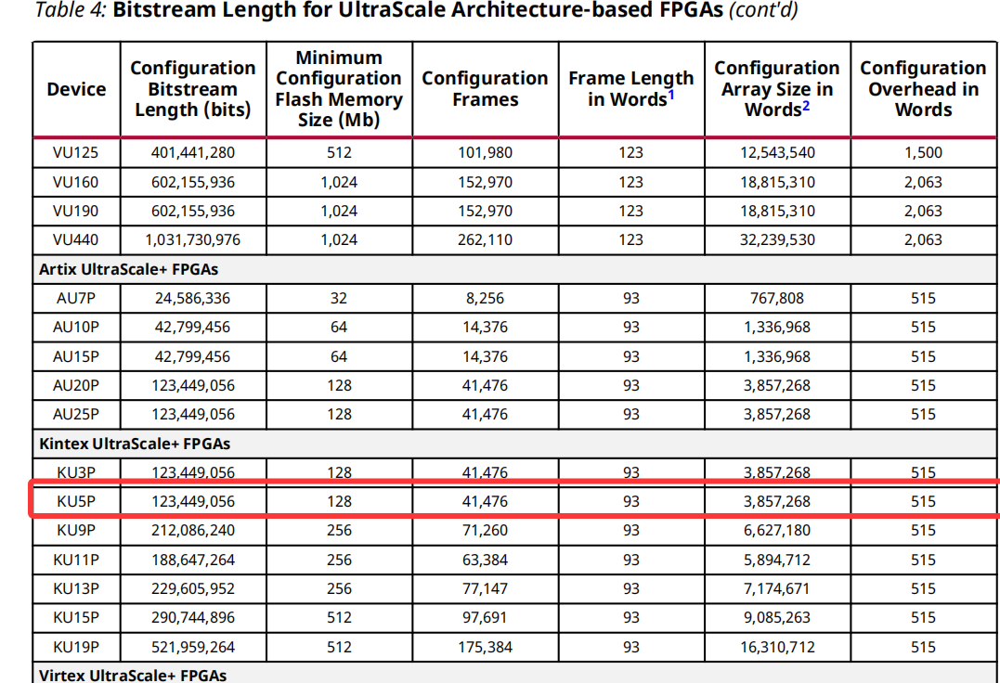 |
| Figure 2-1. Data-sheet excerpt |

The `mt25qu256` Quad-SPI FLASH device has 256 Mb of memory, which is more than twice the stated minimum for this FPGA. It uses 1.8 V CMOS logic. Its nonvolatile memory can store an FPGA configuration `.bin` file and other user data, as shown in Figure 2-2.

|  |
|:--:|
| 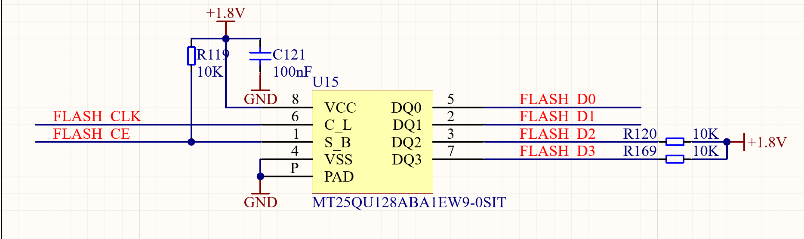 |
| Figure 2-2. Quad-SPI FLASH schematic |

The device stores FPGA configuration `.bin` files. Its pins connect directly to the FPGA, as shown in Figure 2-3.

|  |
|:--:|
| 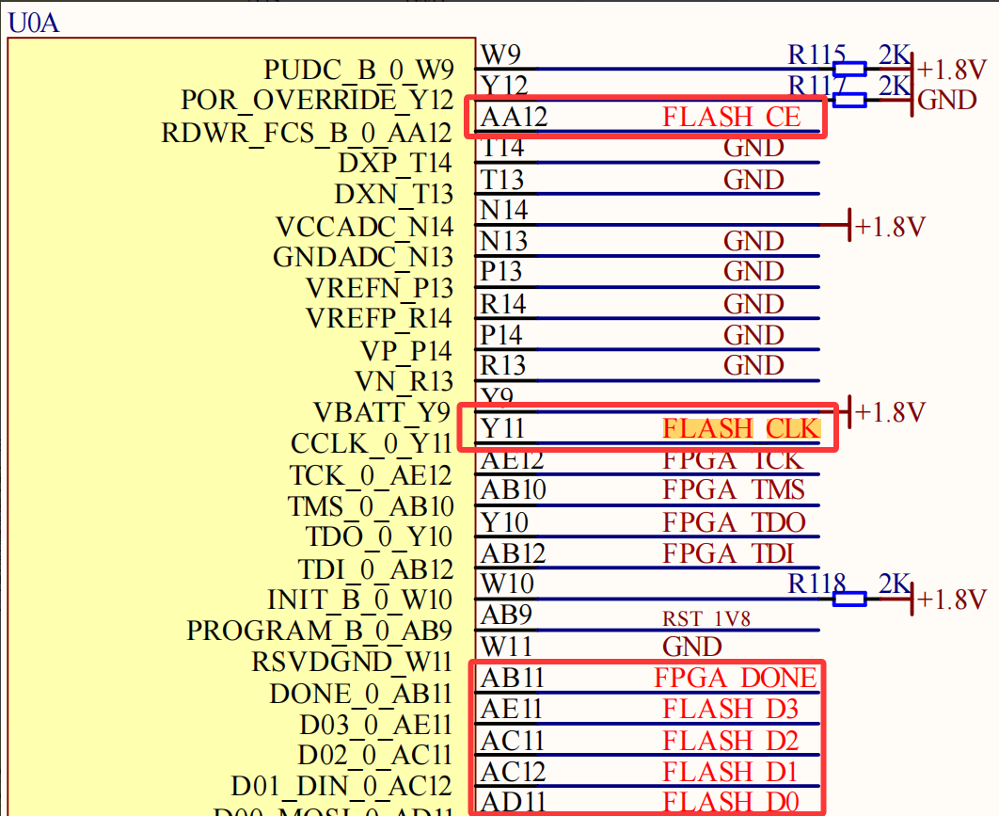 |
| Figure 2-3. Quad-SPI FLASH and FPGA pins |

The data sheet shows that the M0, M1, and M2 configuration pins set SPI master mode, as shown in Figures 2-4 and 2-5.

|  |
|:--:|
|  |
| Figure 2-4. Schematic configuration |
| 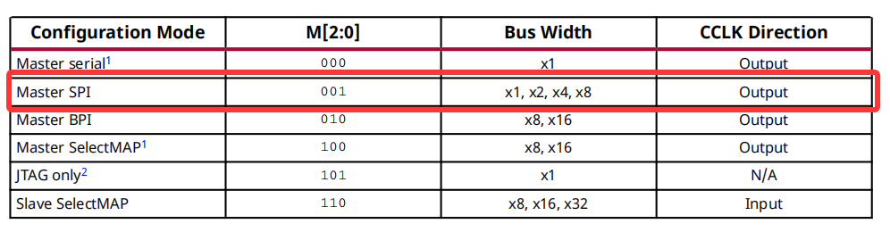 |
| Figure 2-5. Configuration table from the data sheet |

Generate a `.bin` File

Add the Table 2-1 commands to `pin.xdc`.

|                                                                   |
|:------------------------------------------------------------------|
| set_property BITSTREAM.CONFIG.SPI_BUSWIDTH 4 \[current_design\]   |
| set_property CONFIG_MODE SPIx4 \[current_design\]                 |
| set_property BITSTREAM.CONFIG.CONFIGRATE 51.0 \[current_design\]  |
| set_property BITSTREAM.GENERAL.COMPRESS TRUE \[current_design\]   |
| set_property BITSTREAM.CONFIG.UNUSEDPIN Pullup \[current_design\] |
| Table 2-1. Commands to add |

Open Bitstream Settings. Right-click and double-click Bitstream Settings, as shown in Figure 2-6.

|  |
|----|
| 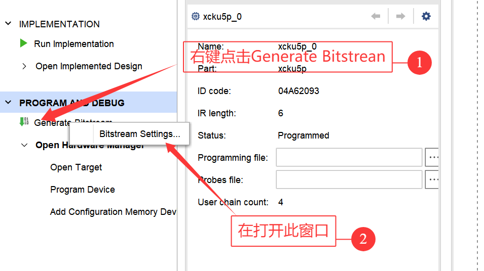 |
| Figure 2-6 |

Select `bin_file` and then select OK, as shown in Figure 2-7.

- `-raw_bitfile`: Generates an unpackaged raw bitstream file, usually `.rbt` or `.bin`, without header information.
- `-mask_file`: Generates a mask file for the bitstream, for partial reconfiguration or security operations.
- `-no_binary_bitfile`: Does not generate the standard binary bitstream file (`.bit`).
- `-bin_file*`: Generates a binary bitstream file.
- `-readback_file`: Generates a readback file to check the bitstream in hardware.
- `-logic_location_file`: Generates a logic-location file for debug or placement analysis.
- `-verbose`: Shows detailed generation output.

|  |
|:--:|
| 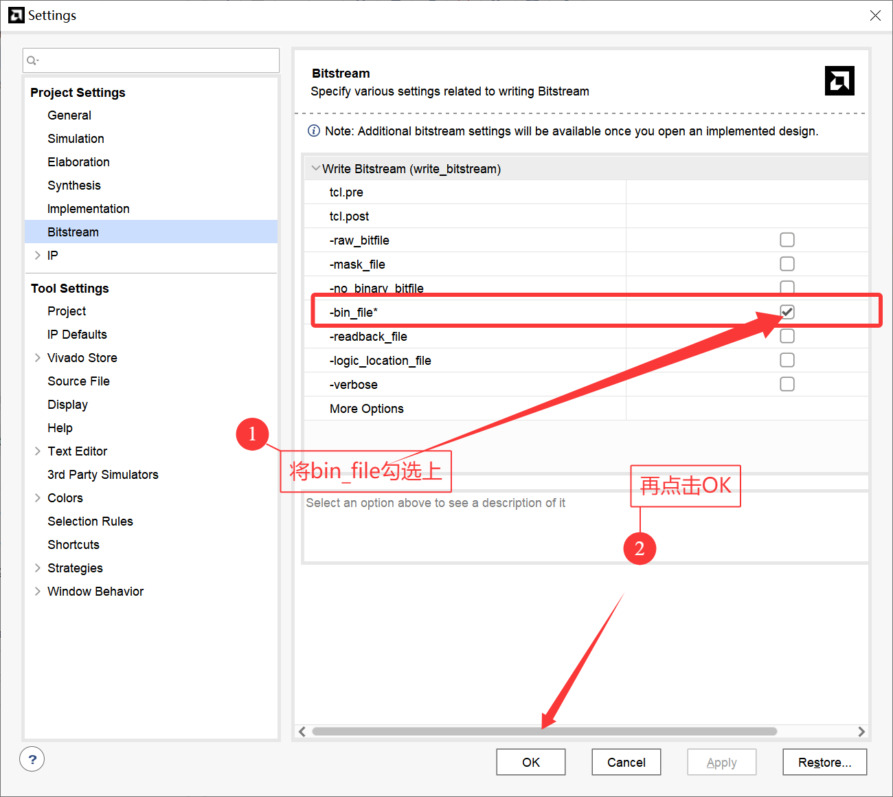 |
| Figure 2-7 |

Generate the bitstream directly, as shown in Figure 2-8.

|  |
|----|
| 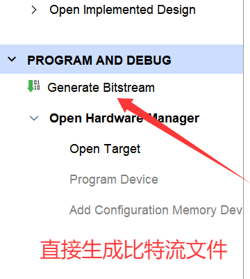 |
| Figure 2-8 |

After the bitstream is generated, the dialog in Figure 2-9 appears.

|  |
|----|
| 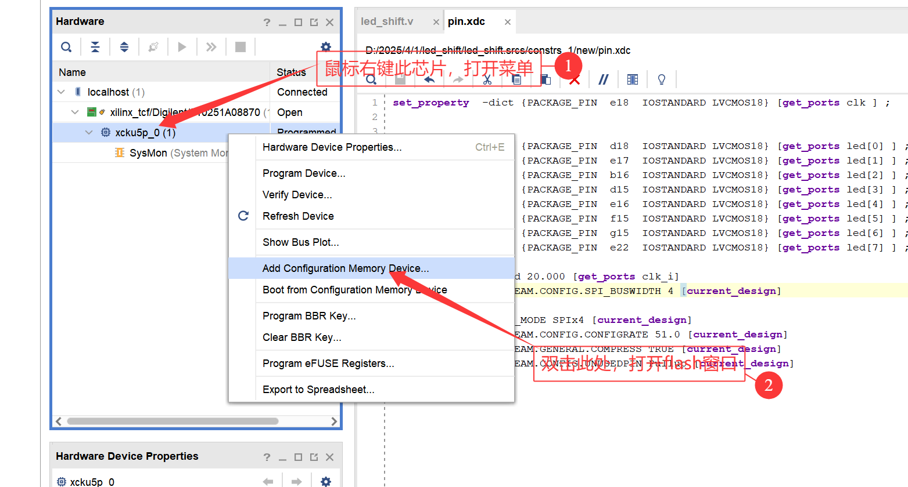 |
| Figure 2-9 |

Select flash device `mt25qu128-spi-x1_x2_x4`.

Do not select `x8`. It represents two flash devices. See Figure 2-10.

|  |
|----|
| 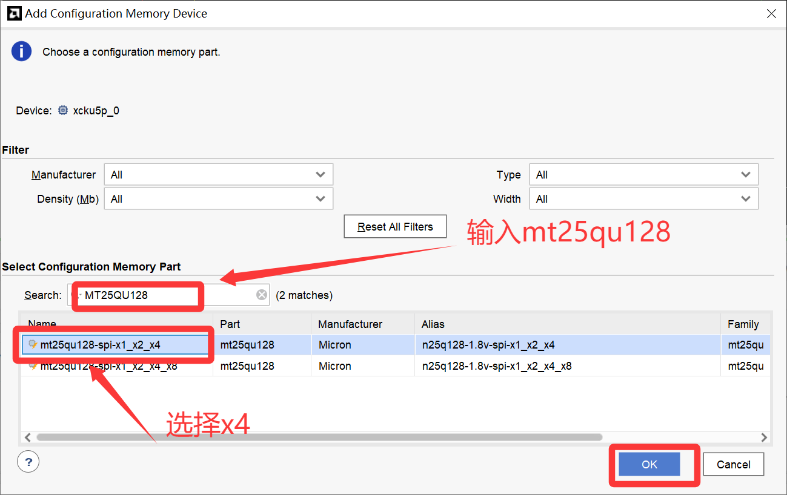 |
| Figure 2-10 |

Select the three dots to open the folder, select the `.bin` file, and select OK.

The file normally is in `runs/impl_1`, as shown in Figure 2-11.

|  |
|----|
| 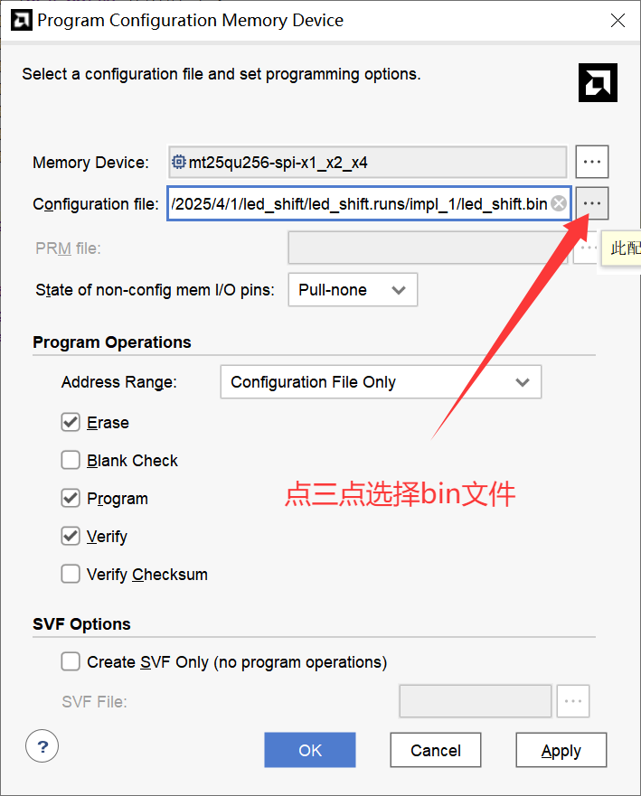 |
| Figure 2-11 |

After flash programming finishes, cycle the power switch or press the reset button (`SW2`). When LED `ld10` lights at power-on, flash startup succeeded and the board runs the stored program.

Figure 2-12 shows the result without the `pin.xdc` commands. The `.bin` file is 15070 Kbyte. Omission of these commands also makes download and startup much slower.

|  |
|----|
|  |
| Figure 2-12. Without the XDC commands |

With the commands, the generated `.bin` file is only 3717 Kbyte, almost four times smaller. See Figure 2-22.

|  |
|----|
| 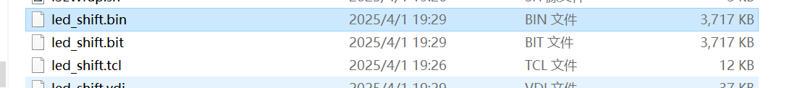 |
| Figure 2-22. Memory with the XDC commands |

The following table explains these commands.

<table>
<colgroup>
<col style="width: 100%" />
</colgroup>
<tbody>
<tr><td></td></tr>
<tr><td>
set_property BITSTREAM.CONFIG.SPI_BUSWIDTH 4 [current_design]

Sets the SPI bus width to <strong>4 bits</strong>.
</td></tr>
<tr><td>
set_property CONFIG_MODE SPIx4 [current_design]

Uses <strong>four-wire SPI mode</strong>.
</td></tr>
<tr><td>
set_property BITSTREAM.CONFIG.CONFIGRATE 51.0 [current_design]

Sets the configuration clock frequency to <strong>51.0 MHz</strong>.
</td></tr>
<tr><td>
set_property BITSTREAM.GENERAL.COMPRESS TRUE [current_design]

Compresses the generated bitstream file.
</td></tr>
<tr><td>
set_property BITSTREAM.CONFIG.UNUSEDPIN Pullup [current_design]

Sets unused FPGA pins to <strong>pull-up</strong> to prevent unstable floating pins.
</td></tr>
</tbody>
</table>

6 Final
