# QSFP 100G Test with the IBERT IP Core

------ Based on the Kintex UltraScale+ KU5P development board

# Function Overview

This document uses the IBERT IP core for a 25G optical-port loopback test. For project creation, see *Light Your LEDs*. Change only the file name.

Vivado

<table><colgroup><col style="width: 50%" /><col style="width: 50%" /></colgroup><tbody>
<tr><td style="text-align: center;">Start page, or File &gt; Project &gt; New</td><td style="text-align: center;">Create a new project.</td></tr>
<tr><td style="text-align: center;">Wizard start page</td><td style="text-align: center;">Select Next.</td></tr>
<tr><td style="text-align: center;">Project Name</td><td style="text-align: center;">
Project name: `QSFP`

Project path: Select a path without Chinese characters.

Select Next.
</td></tr>
<tr><td style="text-align: center;">Add Sources</td><td style="text-align: center;">Select Next.</td></tr>
<tr><td style="text-align: center;">Add Constraints</td><td style="text-align: center;">Select Next.</td></tr>
<tr><td style="text-align: center;">Default Part</td><td style="text-align: center;">Select `xcku5p-ffvb676-2-i`.</td></tr>
<tr><td style="text-align: center;">New Project Summary</td><td style="text-align: center;">Check the project information and device selection, then select Finish.</td></tr>
</tbody></table>

Use the IP Core

Select IP Catalog, enter `ibert` in the search box, and double-click IBERT UltraScale GTY. See Figure 4-1.

|  |
|:---|
| 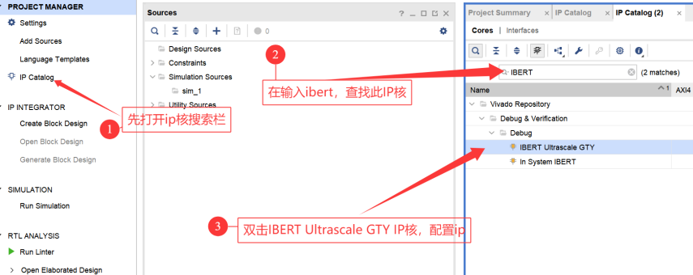 |
| Figure 4-1. Add the IP core |

The schematic shows a 156.25 MHz clock, as shown in Figure 4-2.

|  |
|:---|
| 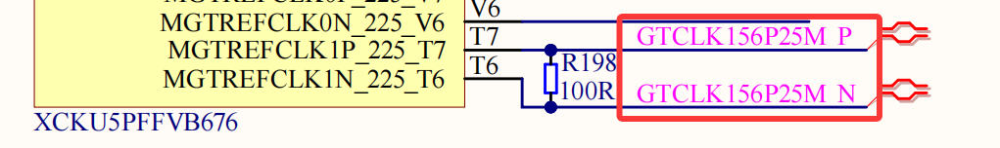 |
| Figure 4-2. Partial schematic |

Set Line Rate to 25G. Set the Refclk frequency to 156.25 MHz. Select Advanced Settings. See Figure 4-3.

|  |
|:--:|
| 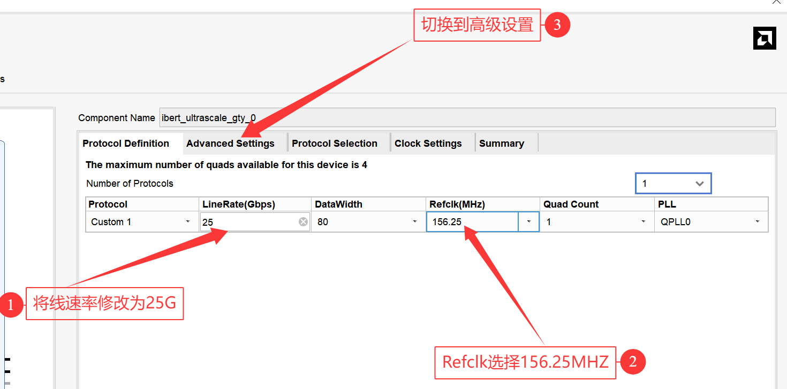 |
| Figure 4-3 |

Keep the default settings on this page and continue, as shown in Figure 4-4.

|  |
|:--:|
| 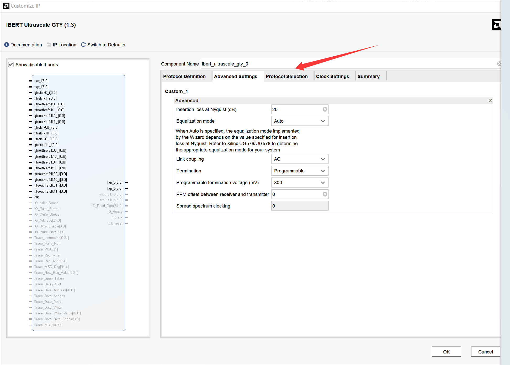 |
| Figure 4-4 |

Set Protocol Selected for `QUAD_224` to None. See Figure 4-5.

|  |
|:--:|
| 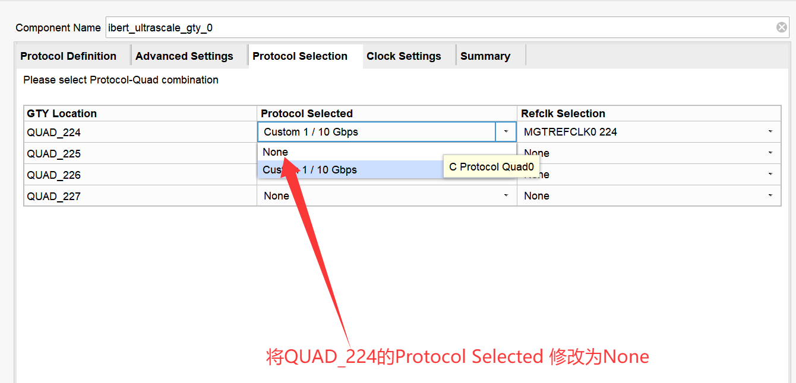 |
| Figure 4-5 |

The schematic shows that the clock is `MGTREDFCLK1_225`, as shown in Figure 4-6.

|  |
|:--:|
| 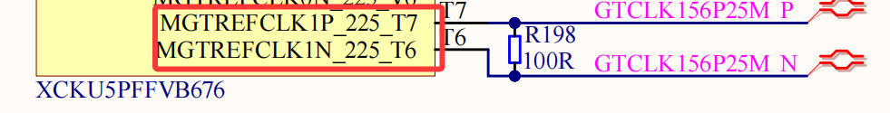 |
| Figure 4-6. Partial schematic |

Set Protocol Selected for `QUAD_225` to Custom 1/10 Gbps. Set Refclk Selection to `MGTREDFCLK1_225`, then open clock settings. See Figure 4-7.

|  |
|:--:|
| 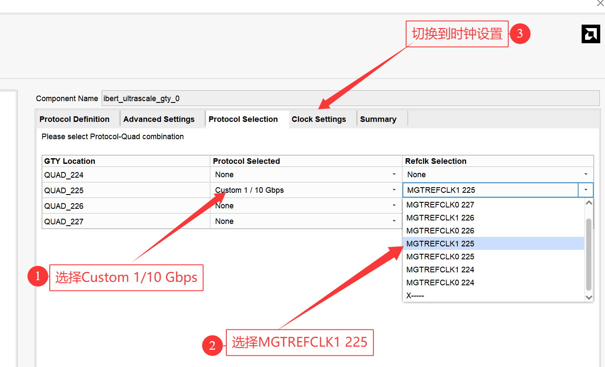 |
| Figure 4-7 |

Set Source to `QUAD255 1`, then open the summary page. See Figure 4-8.

|  |
|:--:|
| 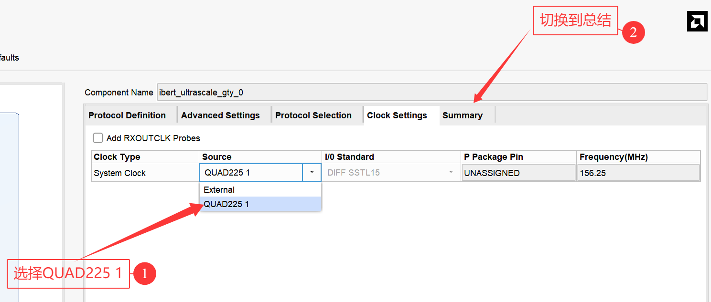 |
| Figure 4-8 |

Check the configuration. If it has no error, select OK. See Figure 4-9.

|  |
|:--:|
| 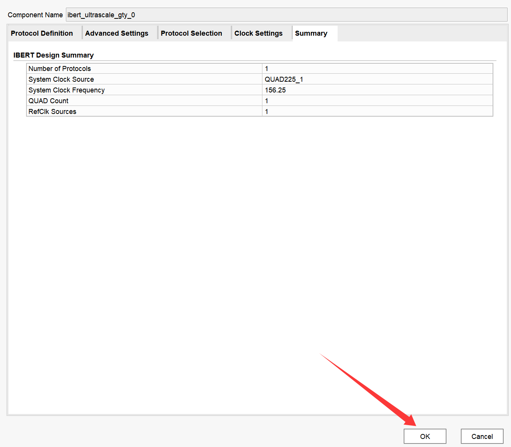 |
| Figure 4-9 |

After the IP core is generated, it appears under Design Sources, as shown in Figure 4-10.

|  |
|:--:|
| 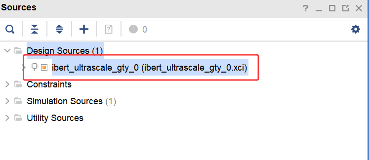 |
| Figure 4-10 |

Select the IP core, right-click it, and select Open IP Example Design. See Figure 4-11.

|  |
|:--:|
| 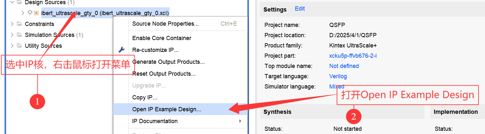 |
| Figure 4-11 |

Select a file location without Chinese characters, then select OK. See Figure 4-12.

|  |
|:--:|
| 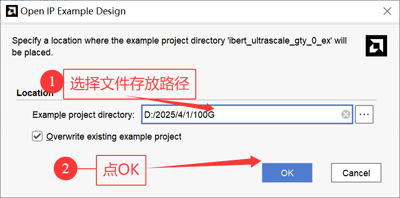 |
| Figure 4-12 |

Wait for Vivado 2024.1 to open a new window. Generate the bitstream in the new Vivado instance. See Figure 4-13.

|  |
|:--:|
| 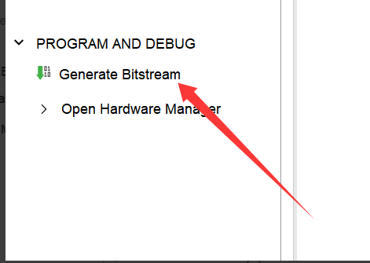 |
| Figure 4-13 |

Connect the development board and program the bitstream as described in *Light Your LEDs*. Install an optical module in the board. See Figure 4-14.

|  |
|:--:|
| 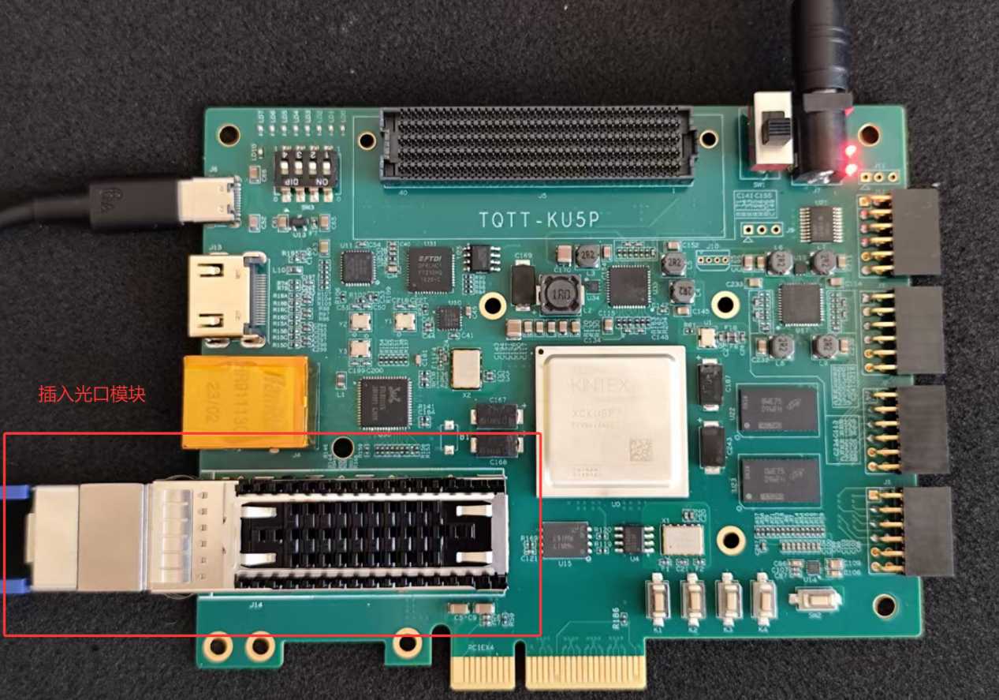 |
| Figure 4-14. Physical connection |

When the Figure 4-15 window appears, select Serial I/O Links and then Auto-detect Links. See Figure 4-16.

|  |
|:--:|
| 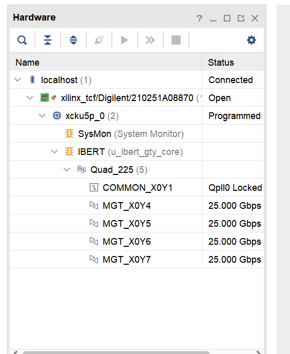 |
| Figure 4-15 |
| 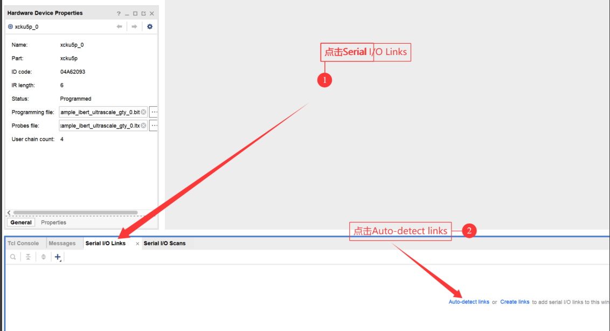 |
| Figure 4-16 |

After you select Auto-detect Links, Vivado shows transfer parameters. Select Reset after each startup to show Figure 4-17.

|  |
|:--:|
| 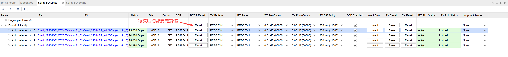 |
| Figure 4-17 |

Select a channel, right-click it, and select Create Scan to view the eye diagram. See Figure 4-18.

|  |
|:--:|
| 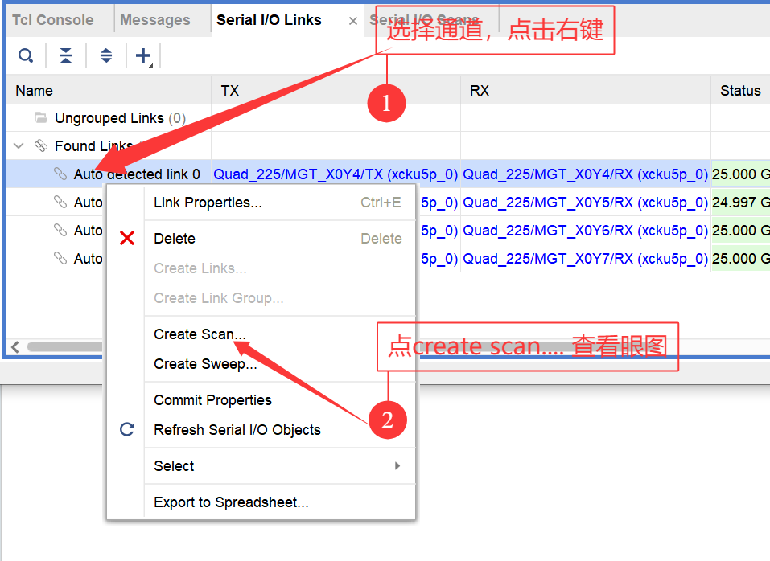 |
| Figure 4-18 |

Select OK to view the eye diagram, as shown in Figure 4-19.

|  |
|:--:|
| 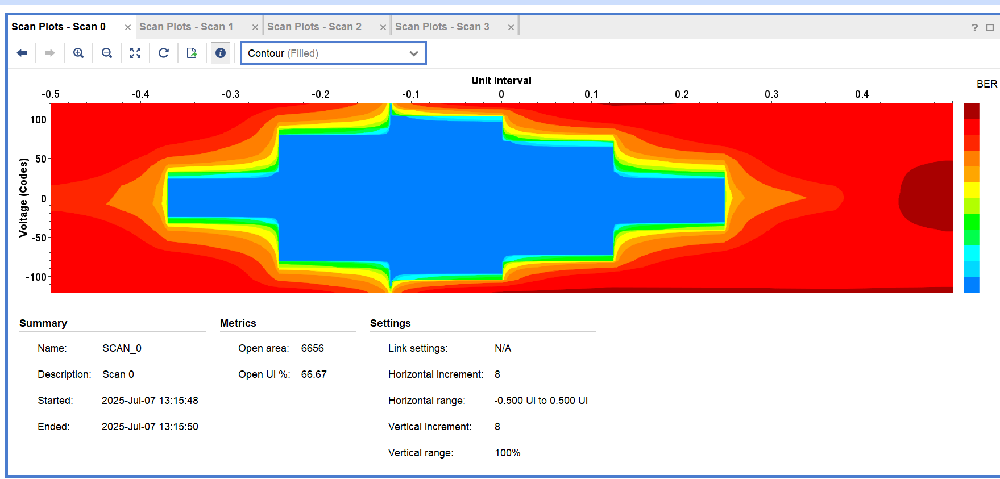 |
| Figure 4-19. Eye diagram |
