# PCIe with the XDMA High-Speed Transceiver

------ Based on the Kintex UltraScale+ KU5P development board

This document uses the XDMA IP core for a PCIe test. For project creation, see *Light Your LEDs*.

Create the Vivado Project

<table><colgroup><col style="width: 50%" /><col style="width: 50%" /></colgroup><tbody>
<tr><td style="text-align: center;">Start page, or File &gt; Project &gt; New</td><td style="text-align: center;">Create a new project.</td></tr>
<tr><td style="text-align: center;">Wizard start page</td><td style="text-align: center;">Select Next.</td></tr>
<tr><td style="text-align: center;">Project Name</td><td style="text-align: center;">
Project name: `pcie`

Project path: Select a path without Chinese characters.

Select Next.
</td></tr>
<tr><td style="text-align: center;">Add Sources</td><td style="text-align: center;">Select Next.</td></tr>
<tr><td style="text-align: center;">Add Constraints</td><td style="text-align: center;">Select Next.</td></tr>
<tr><td style="text-align: center;">Default Part</td><td style="text-align: center;">Select `xcku5p-ffvb676-2-i`.</td></tr>
<tr><td style="text-align: center;">New Project Summary</td><td style="text-align: center;">Check the project information and device selection, then select Finish.</td></tr>
</tbody></table>

After you create the project, double-click IP Catalog, enter `xdma`, and double-click DMA/Bridge to open the IP configuration window. See Figure 5-1.

|  |
|:--:|
| 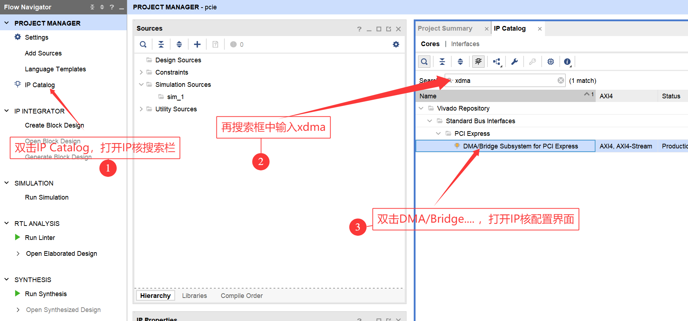 |
| Figure 5-1 |

Select x4 width. Select 8.0 GT/s rate. Continue to the next configuration page, as shown in Figure 5-2.

|  |
|:--:|
| 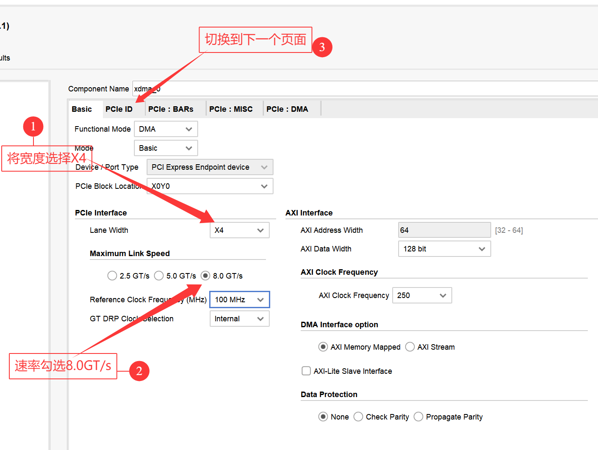 |
| Figure 5-2 |

Do not change this page. Continue to the next page, as shown in Figure 5-3.

|  |
|:--:|
| 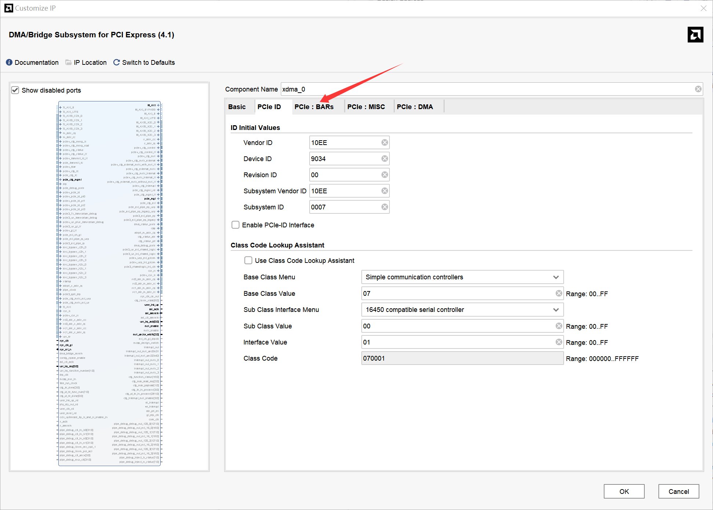 |
| Figure 5-3 |

Do not change this page. Continue to the next page, as shown in Figure 5-4.

|  |
|:--:|
| 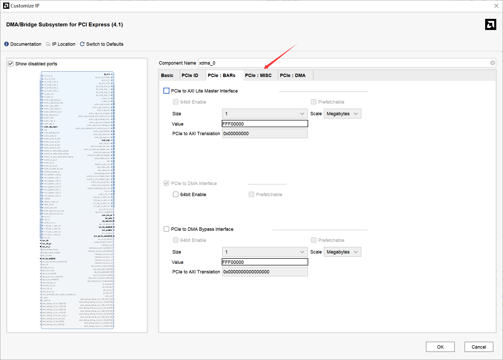 |
| Figure 5-4 |

Do not change this page. Continue to the next page, as shown in Figure 5-5.

|  |
|:--:|
| 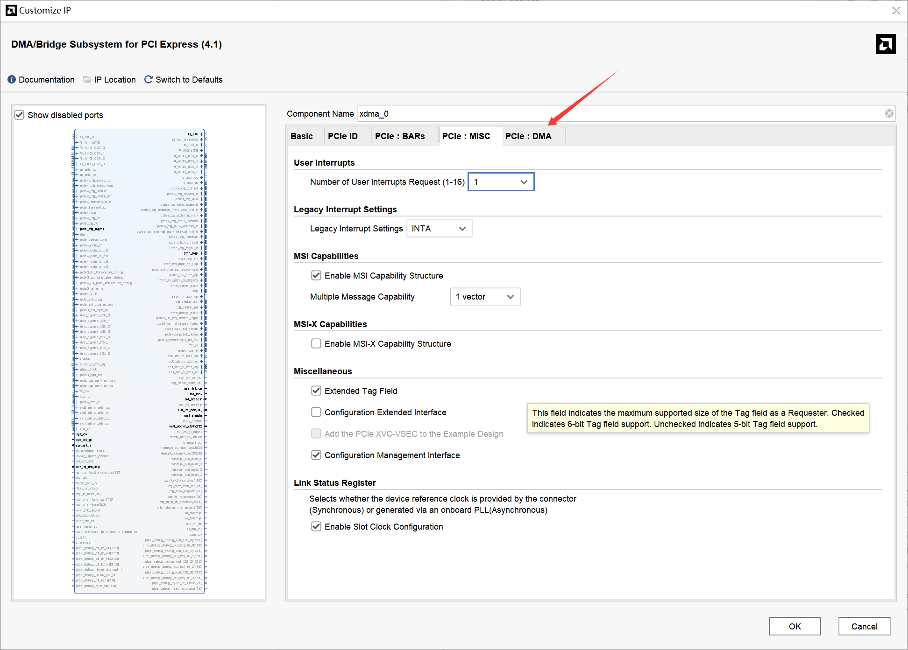 |
| Figure 5-5 |

Set both DMA read and write channels to four. Select OK to create the IP core. See Figure 5-6.

|  |
|:--:|
| 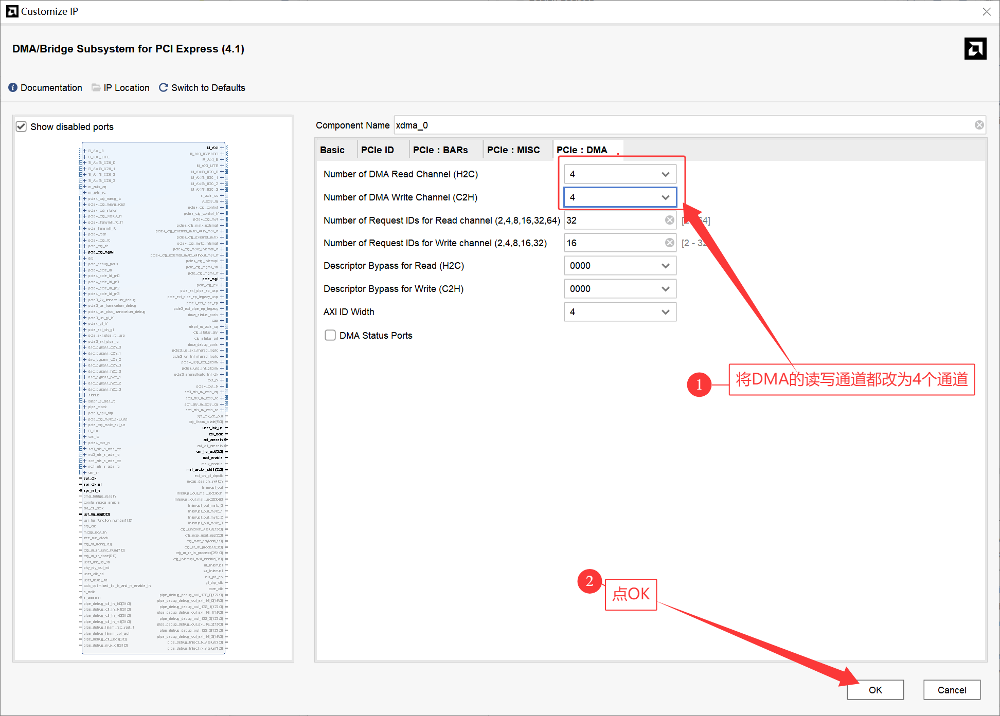 |
| Figure 5-6 |

Select Generate, as shown in Figure 5-7.

|  |
|:--:|
| 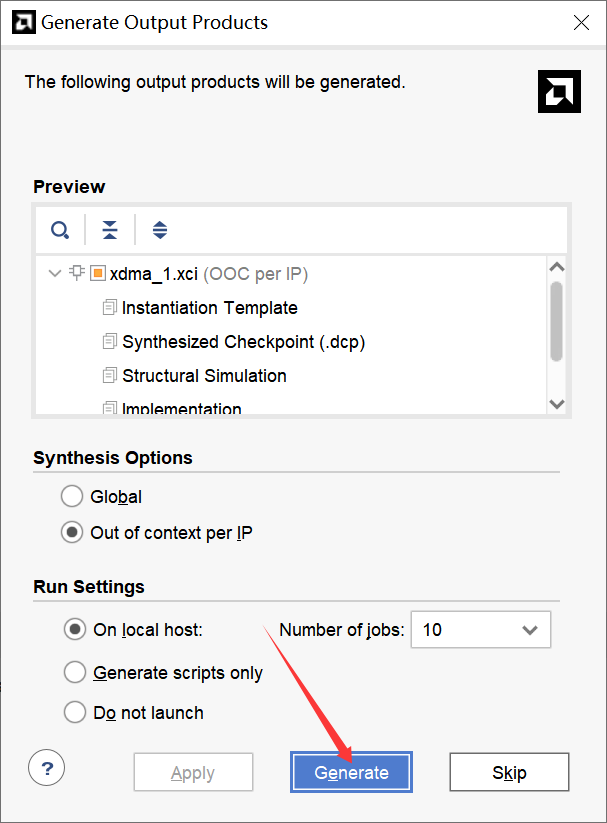 |
| Figure 5-7 |

After the IP core is generated, select it, right-click it, and double-click Open IP Example Design. See Figure 5-8.

|  |
|:--:|
| 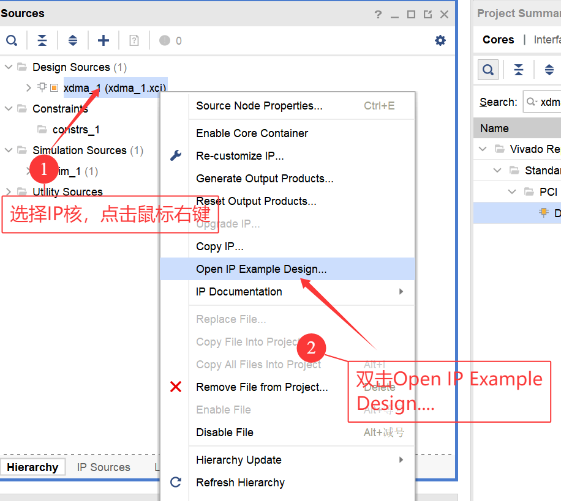 |
| Figure 5-8 |

Enter the project location and select OK, as shown in Figure 5-9.

|  |
|:--:|
| 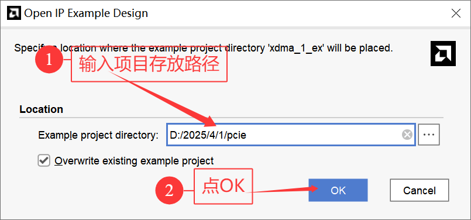 |
| Figure 5-9 |

After a new Vivado window opens, configure the flash as described in *Programming Files and Persistent Configuration*. In the reopened Vivado project, uncomment line 83 of the XDC file by removing `#`. See Figure 5-10.

|  |
|:--:|
| 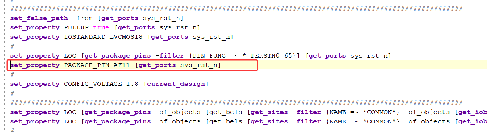 |
| Figure 5-10 |

Use the schematic to identify the pin assigned to `sys_rst_n`, as shown in Figure 5-11.

|  |
|:--:|
|  |
| Figure 5-11 |

The schematic shows that you must change `AF11` to `F22`, as shown in Figure 5-12.

|  |
|:--:|
| 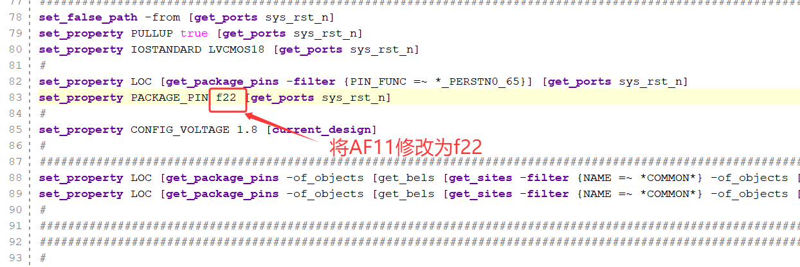 |
| Figure 5-12 |

Add the following PCIe pin assignments to the XDC file.

|                                                               |
|---------------------------------------------------------------|
| set_property PACKAGE_PIN af7 \[get_ports {pci_exp_txp\[3\]}\] |
| set_property PACKAGE_PIN af2 \[get_ports {pci_exp_rxp\[3\]}\] |
| set_property PACKAGE_PIN ae9 \[get_ports {pci_exp_txp\[2\]}\] |
| set_property PACKAGE_PIN ae4 \[get_ports {pci_exp_rxp\[2\]}\] |
| set_property PACKAGE_PIN ad7 \[get_ports {pci_exp_txp\[1\]}\] |
| set_property PACKAGE_PIN ad2 \[get_ports {pci_exp_rxp\[1\]}\] |
| set_property PACKAGE_PIN ac5 \[get_ports {pci_exp_txp\[0\]}\] |
| set_property PACKAGE_PIN ab2 \[get_ports {pci_exp_rxp\[0\]}\] |
| set_property PACKAGE_PIN ab7 \[get_ports sys_clk_p\]          |

Add the following commands to the XDC file to program flash.

|                                                                   |
|:------------------------------------------------------------------|
| set_property BITSTREAM.CONFIG.SPI_BUSWIDTH 4 \[current_design\]   |
| set_property CONFIG_MODE SPIx4 \[current_design\]                 |
| set_property BITSTREAM.CONFIG.CONFIGRATE 51.0 \[current_design\]  |
| set_property BITSTREAM.GENERAL.COMPRESS TRUE \[current_design\]   |
| set_property BITSTREAM.CONFIG.UNUSEDPIN Pullup \[current_design\] |

Save the project and generate the bitstream.

Then use *Programming Files and Persistent Configuration* to store the program on the development board.

Remove the serial connection and power from the programmed board. Install the board in a Linux computer.

CAUTION: Turn off the computer before you install or remove the board. Do not install or remove the board while power is on. See Figure 5-13.

|  |
|:--:|
|  |
| 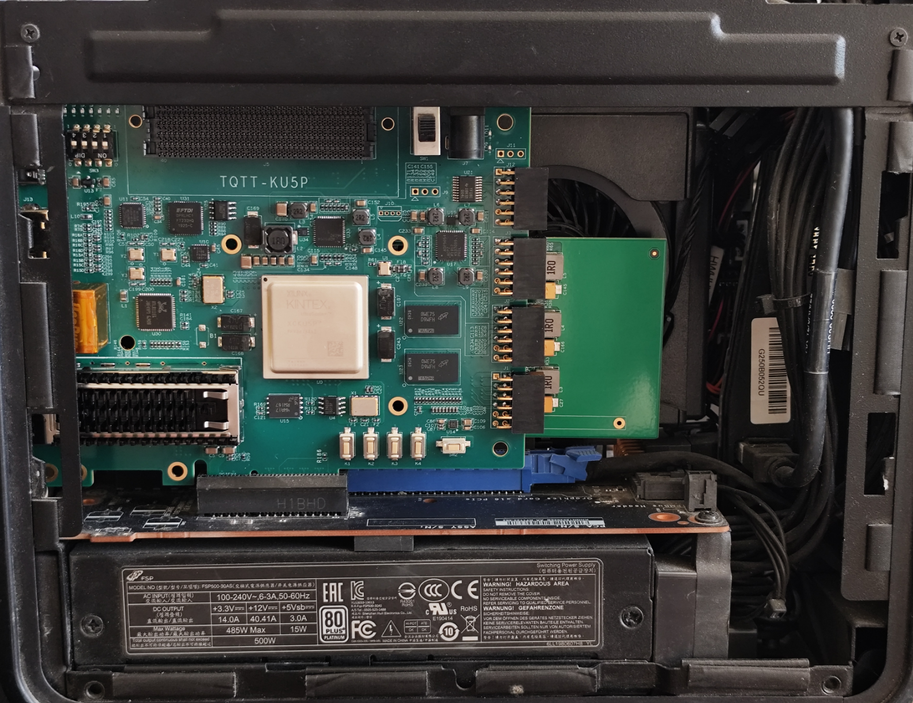 Figure 5-13 |

After you install the board, start the computer. Press Ctrl+Alt+T to open a terminal. Enter `lspci | grep X` and press Enter. See Figure 5-14.

|  |
|:--:|
| 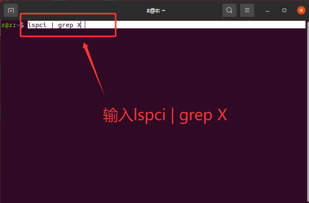 |
| Figure 5-14 |

The command shows device information. `Xilinx Corporation Device 9034` confirms that the computer identified the device. See Figure 5-15.

|  |
|:--:|
| 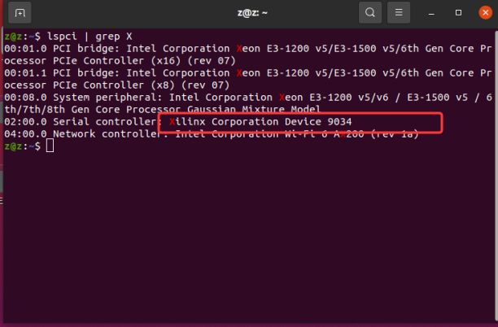 |
| Figure 5-15 |
