# DDR4 SDRAM (MIG) Test

This example tests DDR4 SDRAM with the Memory Interface Generator (MIG) IP core on the Kintex UltraScale+ KU5P development board.


The board uses two `MT40A256M16GE-075E` DDR4 devices. They form a 32-bit data bus with 1 GB capacity. For Vivado project creation and bitstream programming, refer to the *Light Your LED* guide.

## Create the Vivado project

| Wizard page | Action |
|---|---|
| Start page, or **File -> Project -> New** | Create a new project. |
| Wizard start page | Click **Next**. |
| Project Name | Set the project name to `ddr4`. Select a project path that contains no Chinese characters. Click **Next**. |
| Add Sources | Click **Next**. |
| Add Constraints | Click **Next**. |
| Default Part | Select `xcku5p-ffvb676-2-i`. |
| New Project Summary | Check the project information and part selection. Click **Finish**. |

## Add and configure the DDR4 IP core

1. Double-click **IP Catalog**.
2. Enter `ddr4` in the search box.
3. Double-click **DDR4 SDRAM (MIG)**.

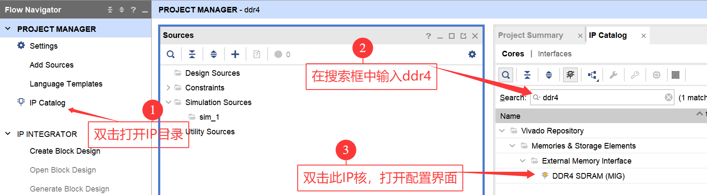

The schematic shows device `MT40A256M16GE-075E`, a maximum address bit of 31, and a 32-bit data width.

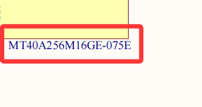
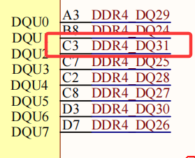

In the IP configuration window, set the input clock to `100 MHz`, the CAS latency to `19`, the device to `MT40A256M16GE-075E`, and the data width to `32`. Click **OK**. Do not change other pages.

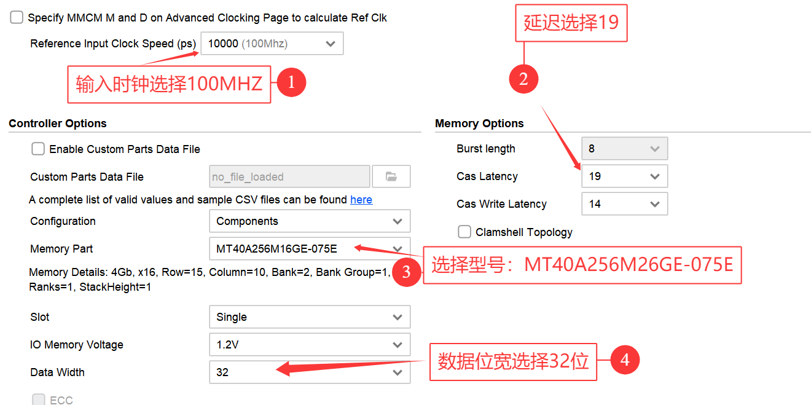

Generate the IP core.

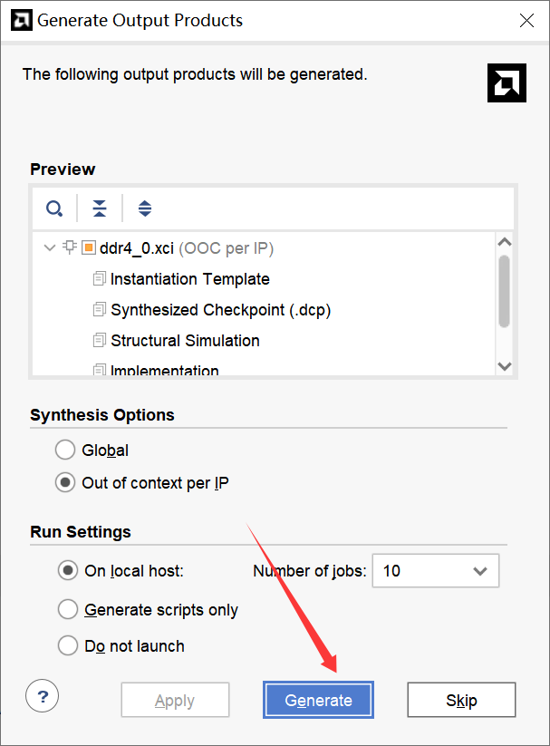

After IP generation completes, select the IP core. Right-click it and double-click **Open IP Example...**.

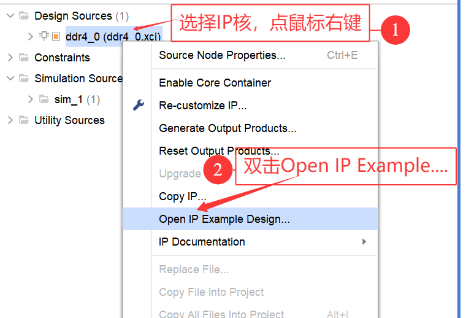

Select a storage path that contains no Chinese characters, then click **OK**.

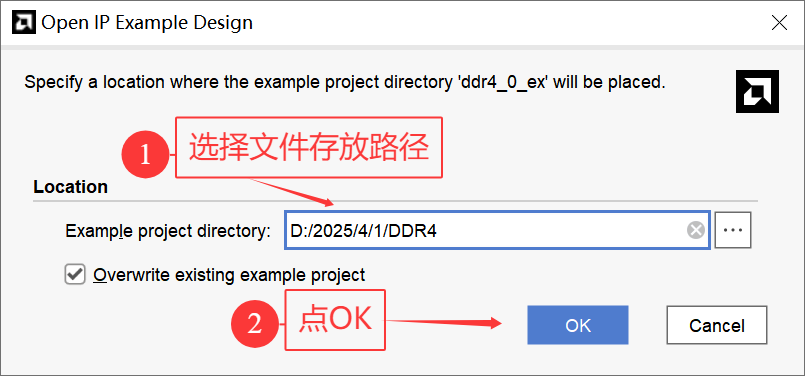

## Modify the example design

In the Vivado window that opens again, double-click the top-level file. Comment out lines 103 and 104. Add a 2-bit `led` output. Then add the following code to the top-level file. `led[1]` lights when DDR4 runs correctly. `led[0]` lights when DDR4 reports an error.

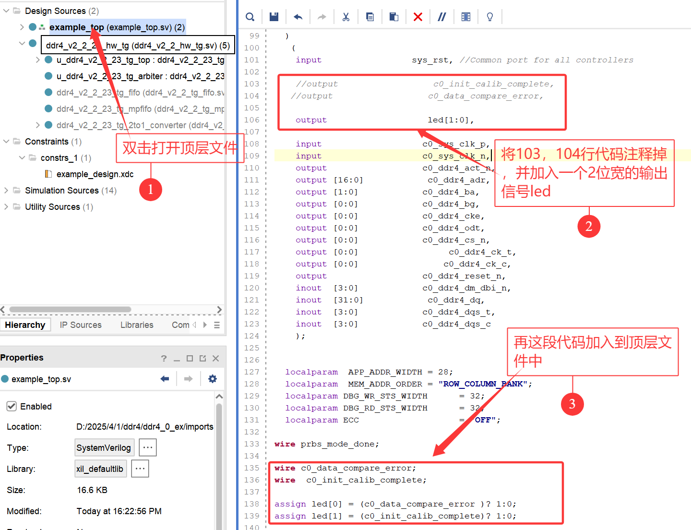

```verilog
wire c0_data_compare_error;
wire c0_init_calib_complete;
assign led[0] = (c0_data_compare_error )? 1:0;
assign led[1] = (c0_init_calib_complete)? 1:0;
```

Table 6-1. Code to add to the top-level file.

Determine the DDR4 pin names from the schematic and write the XDC file.

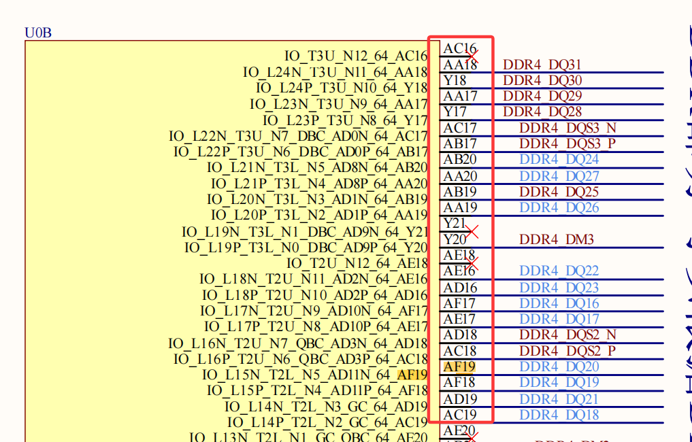

The DDR4 interface has many pins. The source does not show the constraint code. It stores the pin-binding code in [`pin.txt`](pin.txt).

Open the XDC folder. Replace the XDC file contents with the code in `pin.txt`.

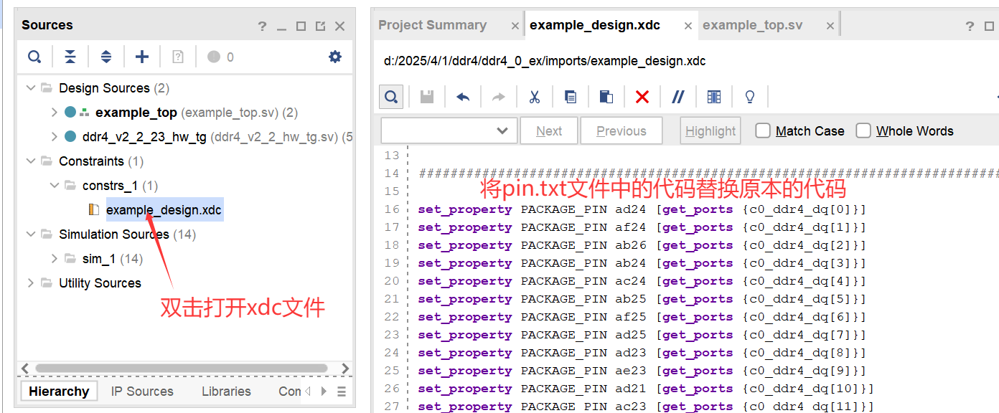

Save the file and generate the bitstream.

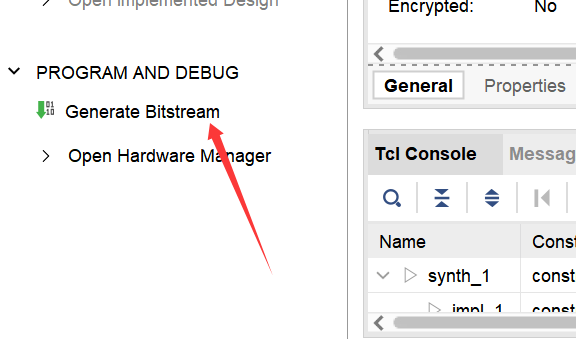

Connect the board and program the bitstream. Refer to the *Light Your LED* guide for the detailed programming steps. The test passes when the shown information appears and `led[1]` lights. The test fails when `led[0]` lights.

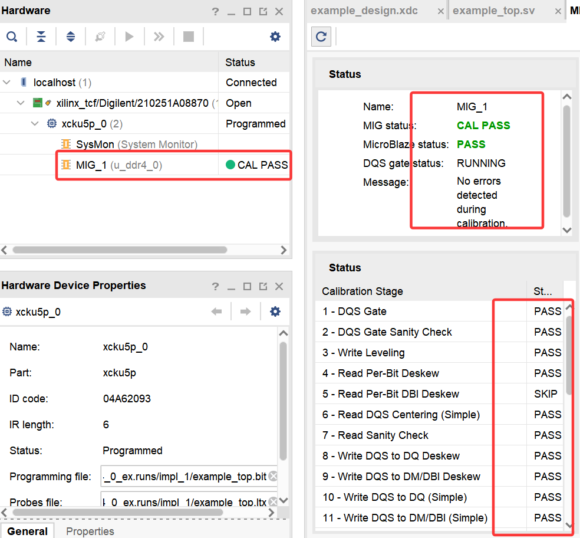
