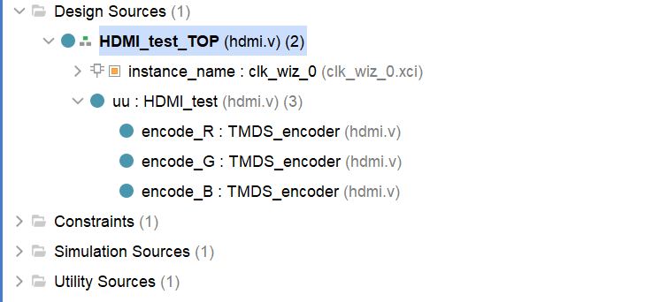
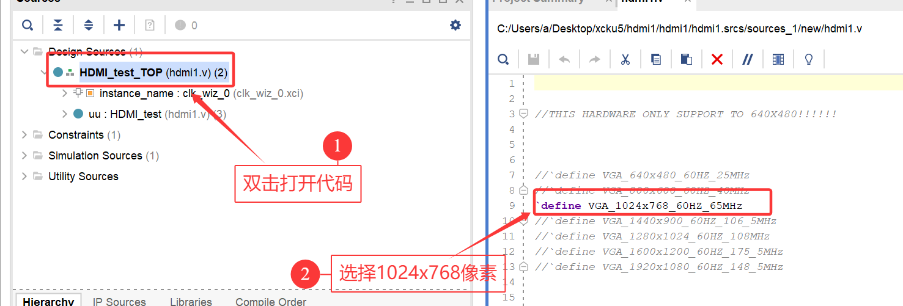
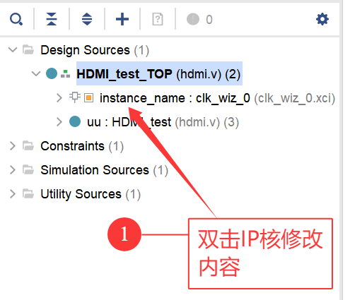
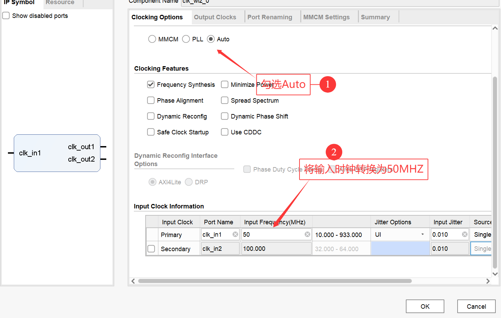
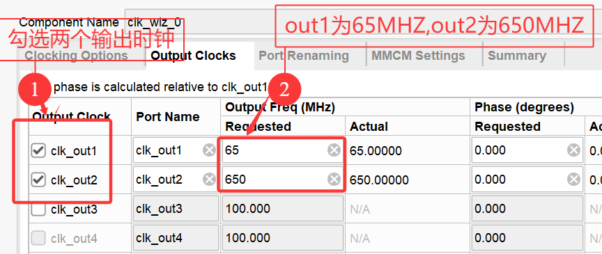
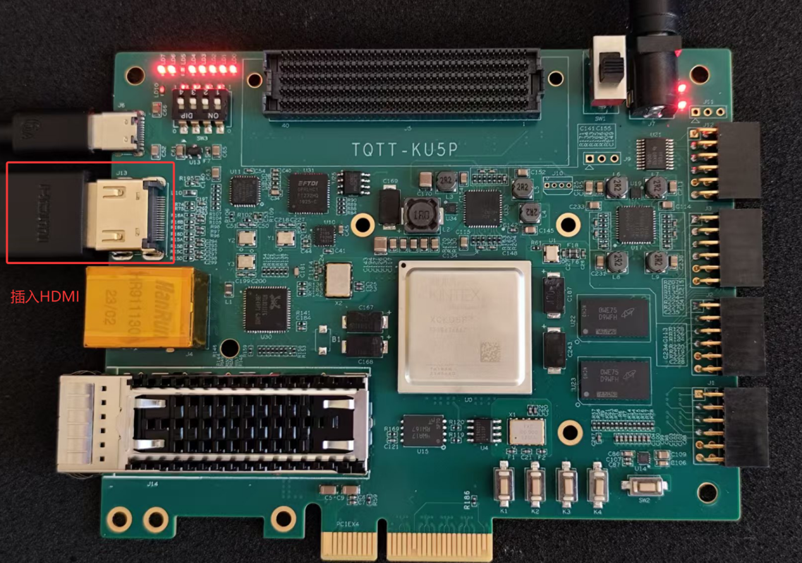

# HDMI Display Test

This example displays an image through HDMI on the Kintex UltraScale+ KU5P development board. It first generates VGA timing, then converts the VGA timing to HDMI timing for HDMI output. The supplied project includes the tutorial source files.

## Open the Vivado project

| Wizard page | Action |
|---|---|
| Start page | Open a project. |
| Wizard start page | Enter the project location in **File name**. Find `HDMI.xpr` and click **Open**. |

After you open the project, double-click the code. The top-level file instantiates an IP core that generates the clocks for each display resolution. The `HDMI_test` module converts VGA timing to HDMI timing.

Lines 3 through 13 select the display resolution. This tutorial uses `1024x768_60HZ_65MHz`.

To use another resolution, remove the comment from that resolution and comment out the other resolutions.

## Configure the clock IP core

Double-click the IP core. This project uses a clock IP core.

In the IP configuration window, select **Auto** and set the input clock to `50 MHz`.

Select two output clocks. Set `out1` to `65 MHz` and `out2` to `650 MHz`, then click **OK**.

`out1` supplies the pixel clock. `out2` supplies a clock ten times the pixel clock for HDMI serial-data encoding. Other resolutions require different clocks.

Generate the bitstream. Refer to the *Program and Store the Program* guide to store the project in the development board. Connect the development board to the HDMI display as shown. You do not need a serial connection because the flash already contains the program.

Turn on the switch. `LD5` flashes and the other LEDs stay on. The display shows the result below. This result means that the test passes.

