# SD card sector read and write test

This example uses the FPGA to write and read SD card sectors through SPI. It targets the Kintex UltraScale+ KU5P board.

## Open the project

1. Start Vivado.
2. Select **Open Project**.
3. Select `XCKU5P_sd/XCKU5P_PRJ.xpr`.
4. Examine **Design Sources**.

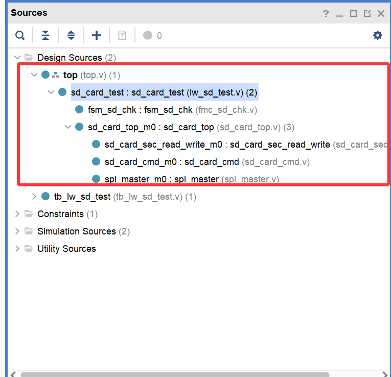

The first recovered image was a document cover graphic.

## Modules

| Module | Function |
| --- | --- |
| `top` | Top-level module. |
| `sd_card_test` | SD card test core. |
| `fsm_sd_chk` | Test state machine. |
| `sd_card_top` | Low-level SD card driver. |
| `sd_card_sec_read_write` | Sector read and write controller. |
| `sd_card_cmd` | SD command controller. |
| `spi_master` | SPI transfer module. |

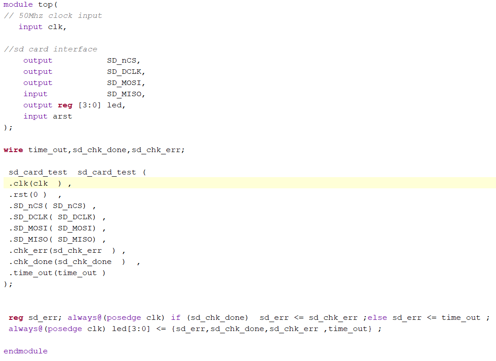

The source archive uses the names in the table. The legacy document uses two older names. The roles match.

## `top` module

| Signal | Function |
| --- | --- |
| `clk` | 50 MHz system clock. |
| `SD_nCS` | Active-low SD card chip select. |
| `SD_DCLK` | SPI clock from the FPGA. |
| `SD_MOSI` | FPGA-to-card SPI data. |
| `SD_MISO` | Card-to-FPGA SPI data. |
| `led` | Test status display. |
| `arst` | System reset. This example does not use it. |

`top` is the project top level. It has three inputs and four outputs. The table gives every documented signal. `arst` is a reset input, but this design does not use it.

The module instantiates the SD card test core. It shows `{sd_err, sd_chk_done, sd_chk_err, time_out}` on `led[3:0]`. `sd_err` stores `sd_chk_err` when the test ends. Otherwise, it shows `time_out`.

The complete listing is [`top.v`](XCKU5P_sd/XCKU5P_PRJ.srcs/sources_1/new/top.v).

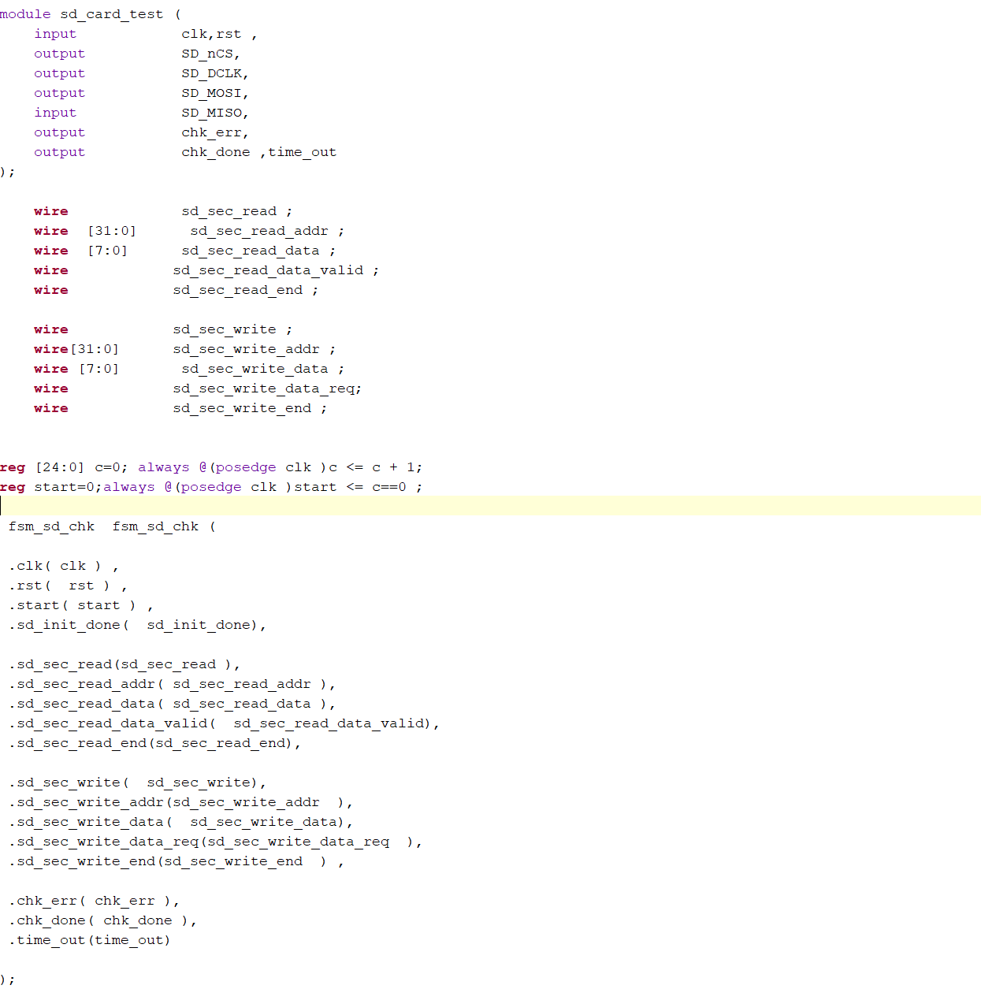

## `sd_card_test` module

`sd_card_test` is the SD card test core. It instantiates `fsm_sd_chk` and `sd_card_top`. The state machine controls the test sequence. The SD driver does the low-level SPI communication and sector read and write work.

| Signal | Function |
| --- | --- |
| `clk` | 50 MHz working clock for SPI communication and state-machine timing. |
| `rst` | Active-high reset. It initializes registers and state machines. |
| `SD_nCS` | Active-low card select. The card communicates only when this signal is low. |
| `SD_DCLK` | SPI clock for MOSI and MISO data transfer. |
| `SD_MOSI` | FPGA-to-card data and command line. It sends reset, initialization, read, write, and data values. |
| `SD_MISO` | Card-to-FPGA response, data, and status line. |
| `chk_err` | Active-high card error indicator. |
| `chk_done` | Active-high test-complete indicator. |
| `time_out` | Active-high timeout indicator. It asserts if the card does not respond in time. |

The complete listing is [`sd_card_test.v`](XCKU5P_sd/XCKU5P_PRJ.srcs/sources_1/new/sd_card_test.v).

## `fsm_sd_chk` module

`fsm_sd_chk` is the state-machine module. It uses sequential logic to run the automatic SD card test.

| Signal | Function |
| --- | --- |
| `clk` | 50 MHz working clock. |
| `rst` | Active-high reset. |
| `start` | Test-start signal. |
| `sd_init_done` | Active-high SD initialization-complete signal. |
| `sd_sec_read` | Active-high sector-read enable. |
| `sd_sec_read_addr` | Sector read address. |
| `sd_sec_read_data` | Read data. |
| `sd_sec_read_data_valid` | Active-high valid-read-data signal. |
| `sd_sec_read_end` | Sector-read-complete signal. |
| `sd_sec_write` | Active-high sector-write enable. |
| `sd_sec_write_addr` | Sector write address. |
| `sd_sec_write_data` | Test data to write. |
| `sd_sec_write_data_req` | Write-data request. |
| `sd_sec_write_end` | Sector-write-complete signal. |
| `chk_err` | Test error. |
| `chk_done` | Test complete. |
| `time_out` | Timeout error. |

The complete listing is [`fsm_sd_chk.sv`](XCKU5P_sd/XCKU5P_PRJ.srcs/sources_1/new/fsm_sd_chk.sv).

## Driver layers

`sd_card_top` changes state-machine requests into SPI timing and standard SD commands. It initializes the card, reads and writes sectors, and returns execution status. It instantiates `sd_card_sec_read_write`, `sd_card_cmd`, and `spi_master`.

| Parameter | Function |
| --- | --- |
| `SPI_LOW_SPEED_DIV` | SPI clock divider during SD initialization. |
| `SPI_HIGH_SPEED_DIV` | SPI clock divider after initialization. |

The driver uses `sd_sec_read`, `sd_sec_read_addr`, `sd_sec_read_data`, `sd_sec_read_data_valid`, and `sd_sec_read_end` for reads. It uses `sd_sec_write`, `sd_sec_write_addr`, `sd_sec_write_data`, `sd_sec_write_data_req`, and `sd_sec_write_end` for writes.

`clk` is the 50 MHz system clock and `rst` is active-high. `SD_nCS` is active-low. `SD_DCLK` is the SPI clock. `SD_MOSI` sends commands and data. `SD_MISO` returns commands and data. `sd_init_done` is active after initialization.

The complete listing is [`sd_card_top.v`](XCKU5P_sd/XCKU5P_PRJ.srcs/sources_1/new/sd_card_top.v).

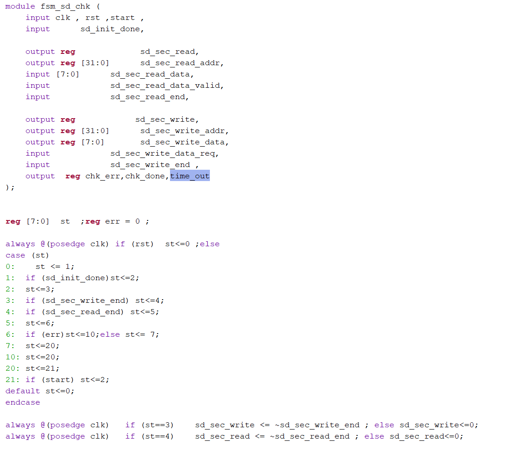

`sd_card_sec_read_write` implements the SD card sector commands. Its `SPI_LOW_SPEED_DIV` parameter controls initialization speed. Its `SPI_HIGH_SPEED_DIV` parameter controls normal transfer speed. It accepts the read and write interface signals above. It also has these lower-level signals: `spi_clk_div`, `cmd_req`, `cmd_req_ack`, `cmd_req_error`, `cmd`, `cmd_r1`, `cmd_data_len`, `block_read_req`, `block_read_valid`, `block_read_data`, `block_read_req_ack`, `block_write_req`, `block_write_data`, `block_write_data_rd`, and `block_write_req_ack`.

It sends `CMD0`, `CMD8`, `CMD55`, `ACMD41`, `CMD16`, `CMD17`, and `CMD24`. It starts at low SPI speed and changes to high speed after initialization.

The complete listing is [`sd_card_sec_read_write.v`](XCKU5P_sd/XCKU5P_PRJ.srcs/sources_1/new/sd_card_sec_read_write.v).

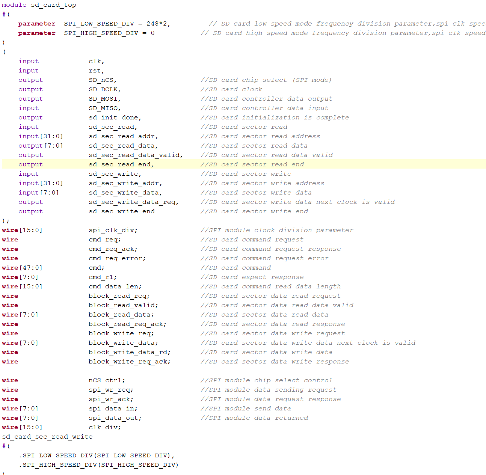

`sd_card_cmd` changes SD commands into SPI transfers. It has the following interfaces: `sys_clk` is the 50 MHz system clock. `rst` is active-high. `spi_clk_div` controls the SPI divider. `cmd_req`, `cmd_req_ack`, and `cmd_req_error` control a command request. `cmd` is a standard SD command. `cmd_r1` is the expected card response. `cmd_data_len` gives the command-data length.

`block_read_req`, `block_read_valid`, `block_read_data`, and `block_read_req_ack` transfer a read block. `block_write_req`, `block_write_data`, `block_write_data_rd`, and `block_write_req_ack` transfer a write block. `nCS_ctrl` controls SPI chip select. `clk_div` gives the SPI clock divider. `spi_wr_req` and `spi_wr_ack` control an SPI write. `spi_data_in` is the transmitted byte. `spi_data_out` is the received byte.

The complete listing is [`sd_card_cmd.v`](XCKU5P_sd/XCKU5P_PRJ.srcs/sources_1/new/sd_card_cmd.v).

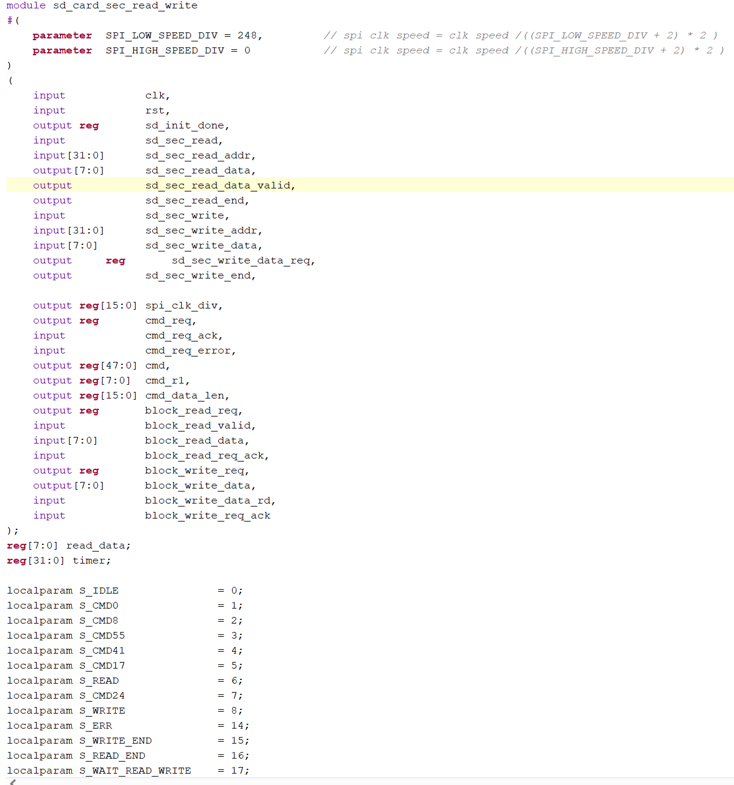

`spi_master` accepts the upper-layer command and sends SPI control and data externally. `sys_clk` is the 50 MHz system clock. `rst` is active-high. `nCS` is active-low chip select. `DCLK` is the divided SPI clock. `MOSI` sends `data_in` bit by bit. `MISO` receives external data bit by bit. `CPOL` selects an idle-low (`0`) or idle-high (`1`) clock. `CPHA` selects the first (`0`) or second (`1`) clock edge for data sampling. SD SPI mode uses `CPOL = 1` and `CPHA = 1` in this project. `nCS_ctrl` controls chip select. `clk_div` sets the divider. `wr_req` requests a byte transfer. `wr_ack` confirms it. `data_out` is the received byte.

The document gives this SPI clock equation:

`DCLK = sys_clk / ((clk_div + 2) * 2)`

The complete listing is [`spi_master.sv`](XCKU5P_sd/XCKU5P_PRJ.srcs/sources_1/new/spi_master.sv).

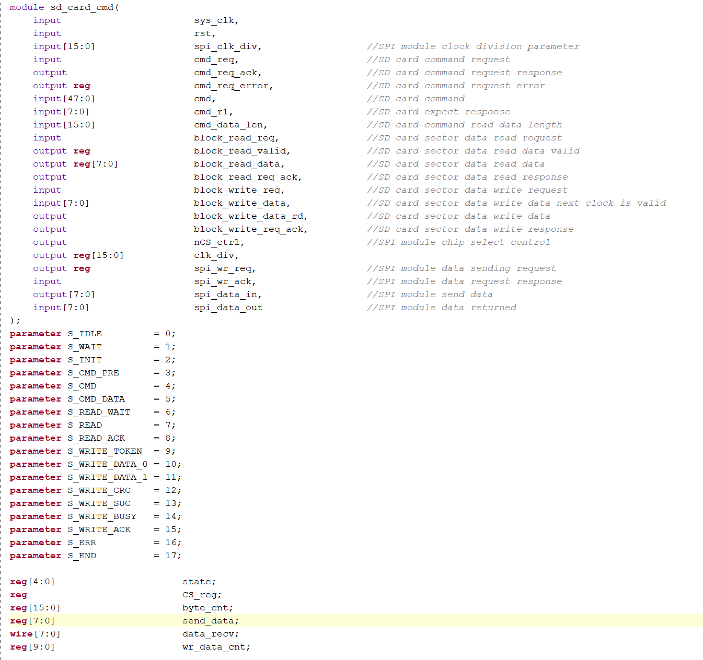

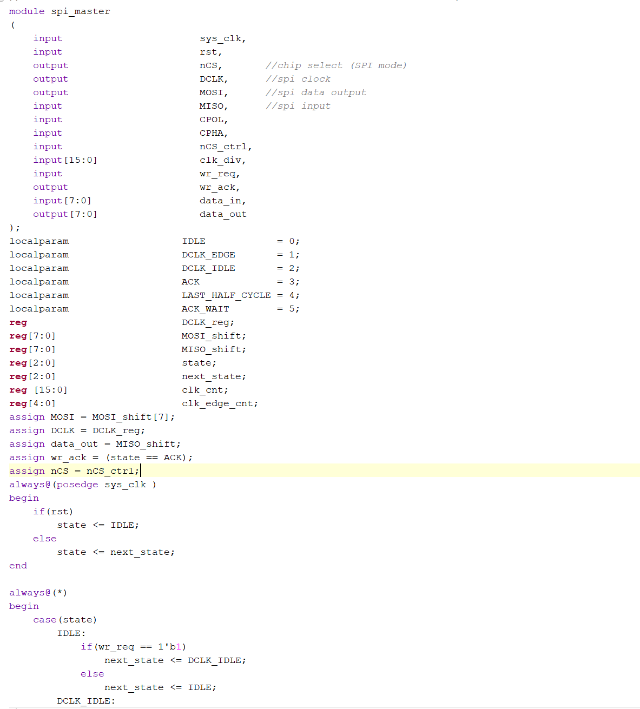

## Run the test

1. Generate a bitstream as in the board LED example.
2. Program the FPGA.
3. Insert an SD card.
4. Observe the LEDs.

With a card inserted, the document states that `LD0` and `LD3` first light. After a delay, `LD2` lights and the other three LEDs turn off. Remove the SD card to change the LED state. A different LED state indicates that the sector read and write test finished successfully.

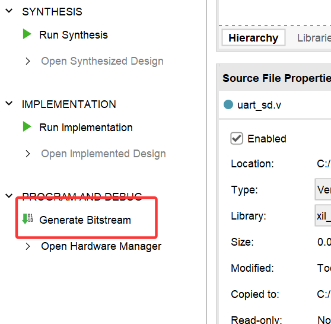

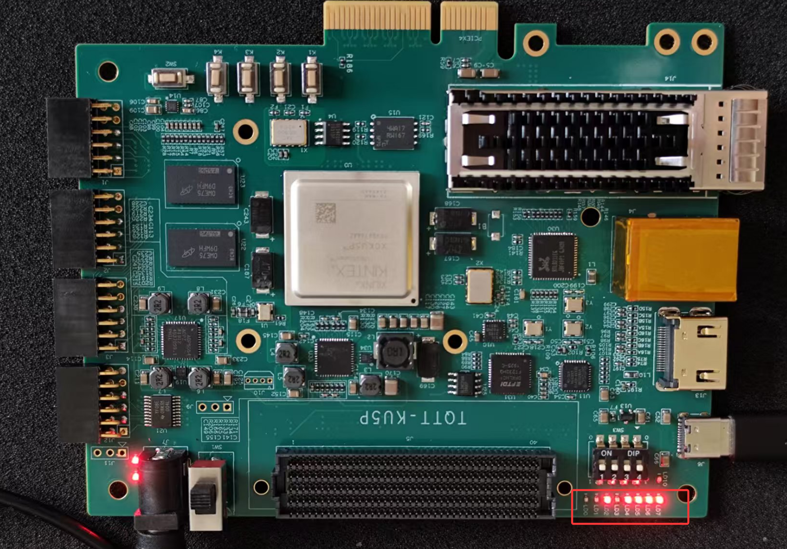

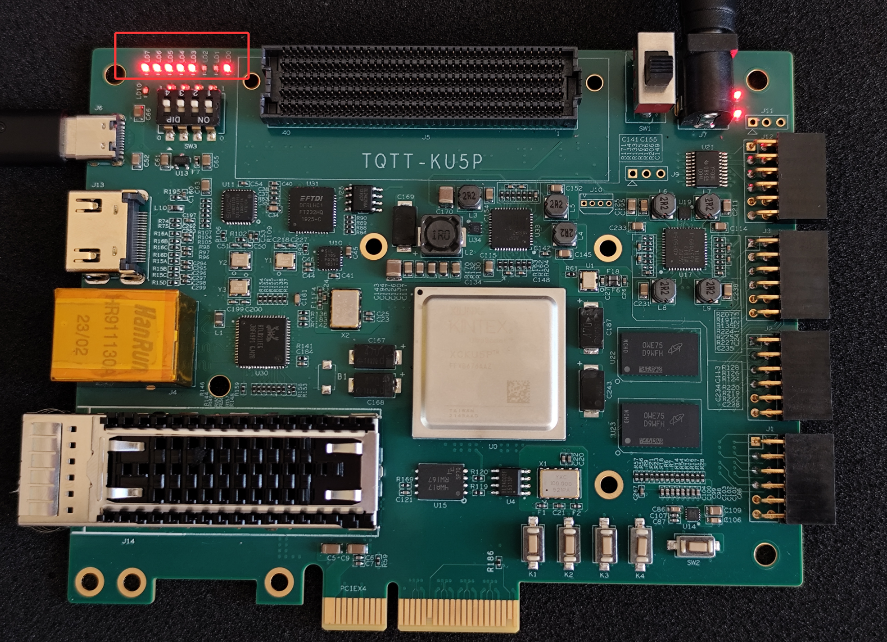

## Source

The full RTL is in [`XCKU5P_sd/XCKU5P_PRJ.srcs/sources_1/new`](XCKU5P_sd/XCKU5P_PRJ.srcs/sources_1/new). The files are `top.v`, `sd_card_test.v`, `fsm_sd_chk.sv`, `sd_card_top.v`, `sd_card_sec_read_write.v`, `sd_card_cmd.v`, and `spi_master.sv`.

## Recovery notes

The source was a legacy WPS `.doc` file. Its OLE container reported an unexpected end of archive, but its `WordDocument`, `0Table`, and `Data` streams were readable. The readable text contained 34,867 UTF-16 characters and 12 inline PNG images. This README captures the recoverable technical instructions and preserves the image order, module names, signal names, command names, formulas, and values. The document duplicated code that exists in the project RTL. The README links to that authoritative source instead of duplicating it.
