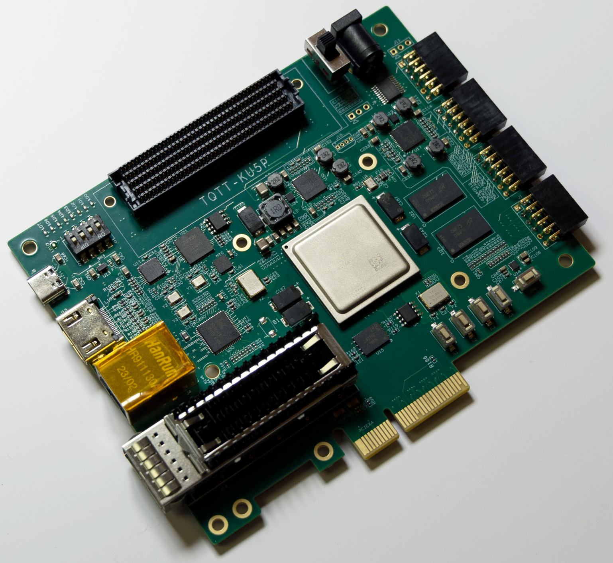
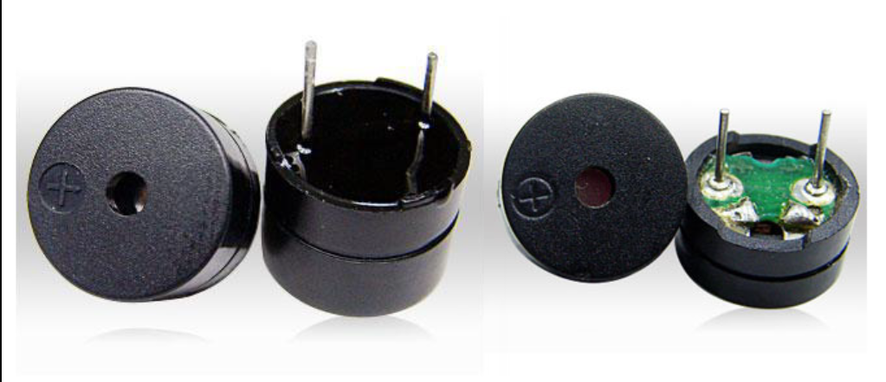
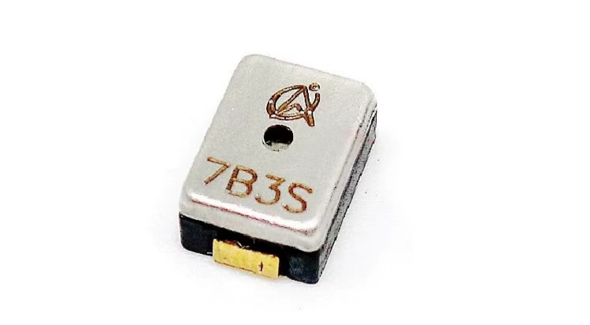
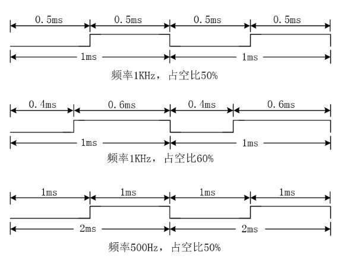
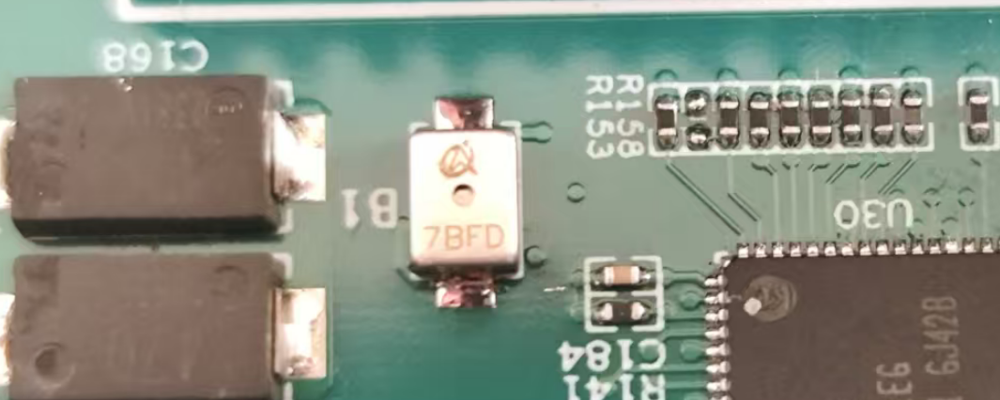
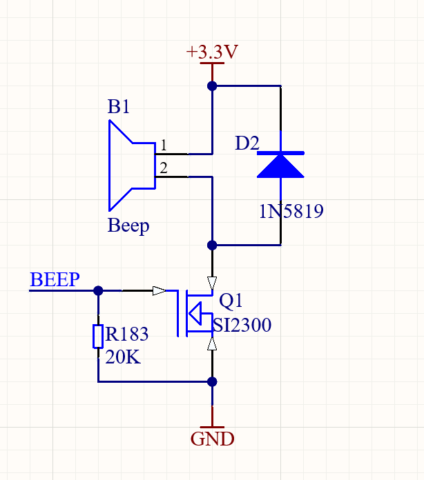
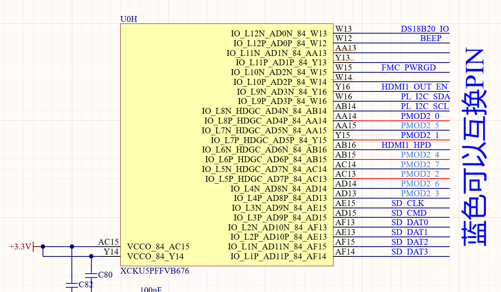
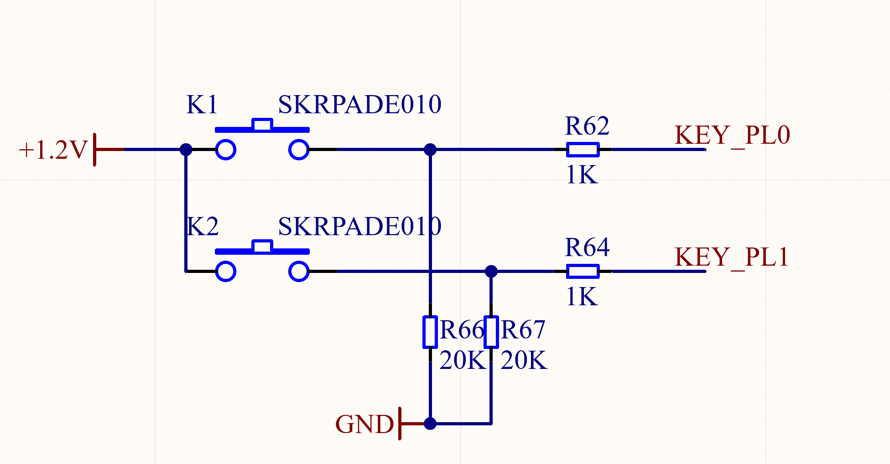
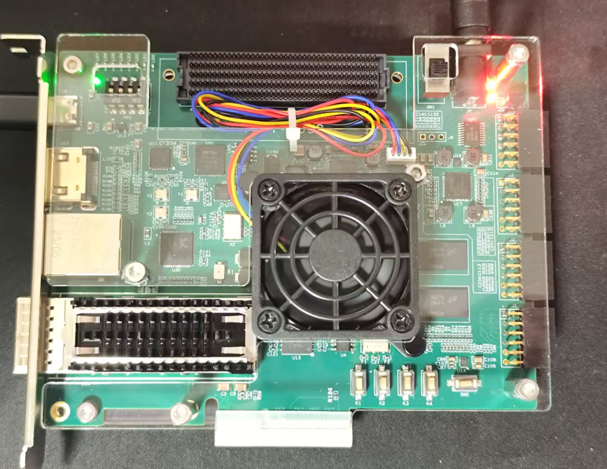

# Buzzer Driver

This example drives a passive buzzer on the Kintex UltraScale+ KU5P development board. It repeats the seven basic notes Do, Re, Mi, Fa, So, La, and Ti. Each note sounds for 0.5 s before the next note starts.



## Buzzer introduction

Buzzer structures include electromagnetic and piezoelectric types. An electromagnetic buzzer contains an oscillator, electromagnetic coil, magnet, vibration diaphragm, and enclosure. A piezoelectric buzzer mainly contains a multivibrator, piezoelectric element, impedance matcher, resonator, and enclosure.

A piezoelectric buzzer uses the piezoelectric effect of ceramic material to vibrate a metal sheet. An electromagnetic buzzer pulls its metal vibration diaphragm when power flows. The diaphragm returns by its elasticity when power stops. The two types use different sound principles. Piezoelectric buzzers have a simple and durable structure, but they have a single tone and poor timbre. They suit equipment such as alarms. Electromagnetic buzzers have better timbre and often suit voice or music equipment.

Buzzers also divide into active and passive types according to whether they include a signal source. An active buzzer contains an integrated circuit. It needs no audio driver circuit and sounds when you apply DC power. A passive buzzer needs an external audio drive signal to sound.



A passive buzzer costs less and lets you control the sound frequency. An active buzzer contains an oscillator. It sounds when you apply suitable DC power, which makes program control easier. This FPGA development board uses a passive buzzer. This document describes the passive-buzzer drive method.



### Passive-buzzer drive principle

Unlike an active buzzer, a passive buzzer contains no oscillator. A DC signal cannot drive it directly. A PWM square wave drives it.

Different PWM square waves produce different sounds. Frequency affects pitch, and duty cycle affects volume. Generate PWM square waves with different frequencies and duty cycles to make the passive buzzer produce different notes.



Figure 1-3 shows PWM waveforms with different frequencies and duty cycles. Different frequencies have different unit-wave durations. Different duty cycles have different high-level proportions in a unit wave. These values let you generate PWM waves with different frequencies and duty cycles.

This example produces seven notes. Frequency controls the note, so the design produces seven frequencies. The duty cycle mainly affects volume. This example uses a fixed 50% duty cycle. The following image shows the frequencies for the seven notes.


## Hardware resources

The board is shown in Figure 1-4.



The schematic in Figure 1-5 shows that a PWM wave at `BEEP` drives the passive buzzer.



## Project code

The project has one module. It generates PWM waves at different frequencies and outputs them in a cycle.

```verilog
module BEEP
#(
parameter TIME_500MS = 25'd24999999, // 0.5 s count value
parameter DO = 18'd190839 , // Do note divider count (frequency 262)
parameter RE = 18'd170067 , // Re note divider count (frequency 294)
parameter MI = 18'd151514 , // Mi note divider count (frequency 330)
parameter FA = 18'd143265 , // Fa note divider count (frequency 349)
parameter SO = 18'd127550 , // So note divider count (frequency 392)
parameter LA = 18'd113635 , // La note divider count (frequency 440)
parameter XI = 18'd101214 // Ti note divider count (frequency 494)
)
(
input wire sys_clk , // System clock, frequency 50 MHz
input wire sys_rst , // System reset, active high
output reg beep // Buzzer control output
);

reg [24:0] cnt ;
reg [17:0] freq_cnt ;
reg [2:0] cnt_500ms ;
reg [17:0] freq_data ;
wire [16:0] duty_data ;

assign duty_data = freq_data >> 1'b1;

always@(posedge sys_clk )
if(sys_rst == 1'b1)
cnt <= 25'd0;
else if(cnt == TIME_500MS )
cnt <= 25'd0;
else
cnt <= cnt + 1'b1;

always@(posedge sys_clk )
if(sys_rst == 1'b1)
cnt_500ms <= 3'd0;
else if(cnt == TIME_500MS && cnt_500ms == 6)
cnt_500ms <= 3'd0;
else if(cnt == TIME_500MS)
cnt_500ms <= cnt_500ms + 1'b1;

always@(posedge sys_clk )
if(sys_rst == 1'b1)
freq_data <= DO;
else case(cnt_500ms)
0: freq_data <= DO;
1: freq_data <= RE;
2: freq_data <= MI;
3: freq_data <= FA;
4: freq_data <= SO;
5: freq_data <= LA;
6: freq_data <= XI;
default: freq_data <= DO;
endcase

always@(posedge sys_clk )
if(sys_rst == 1'b1)
freq_cnt <= 18'd0;
else if(freq_cnt == freq_data || cnt == TIME_500MS)
freq_cnt <= 18'd0;
else
freq_cnt <= freq_cnt + 1'b1;

always@(posedge sys_clk )
if(sys_rst == 1'b1)
beep <= 1'b0;
else if(freq_cnt >= duty_data)
beep <= 1'b1;
else
beep <= 1'b0;
endmodule
```

The module name and parameters define the frequency-divider counts for the notes. For Do, one square-wave period is `1 / 262 ≈ 0.003816794 s = 3816794 ns`. A `50 MHz` system clock period is `1 / 50000000 = 0.00000002 s = 20 ns`. Therefore, `3816794 / 20 ≈ 190840` system-clock cycles generate one PWM wave at frequency 262. The design first counts 190840 system-clock cycles.

Internal signals:

- `cnt_500ms`: Buzzer-state count. The seven notes need seven states, `0` through `6`.
- `cnt`: Note-duration counter. Each note sounds for 0.5 s. At `24999999` (0.5 s), this counter clears and the buzzer-state counter increments.
- `freq_cnt`: Note counter. It counts to the frequency-divider value for the selected note.
- `freq_data`: Note frequency-divider count. It defines the count for the selected note frequency.
- `duty_data`: Duty-cycle count. Change this value to change the PWM duty cycle. This project fixes it at 50%.
- `beep`: Buzzer output-control signal. It outputs a PWM square wave. When `freq_cnt` is greater than or equal to `duty_data`, `beep` is high. Otherwise, `beep` is low. This gives a 50% duty-cycle PWM wave.

The seven states cycle through the notes. Change `freq_data` and `duty_data` to generate PWM waves with different frequencies.

## Pin constraints

Figure 1-6 shows that `BEEP` connects to pin `W12` with a 13.3 V level.



Connect the system-reset input to pushbutton `KEY_PL0`. Figure 1-7 shows that the button is low when you do not push it. The buzzer then operates normally. When you push `K1`, the buzzer enters reset and does not operate.



Use the following pin-constraint file:

```xdc
set_property -dict { PACKAGE_PIN W12 IOSTANDARD LVCMOS33} [get_ports beep]
set_property -dict { PACKAGE_PIN E18 IOSTANDARD LVDCI_18} [get_ports sys_clk]
set_property -dict { PACKAGE_PIN T19 IOSTANDARD LVCMOS12} [get_ports sys_rst]
```

## Board test

Open the project. Refer to the *Program and Store the Program* guide. Generate the bitstream and program the development board. The buzzer then repeats Do, Re, Mi, Fa, So, La, and Ti. When you push `K1`, the buzzer does not operate.


