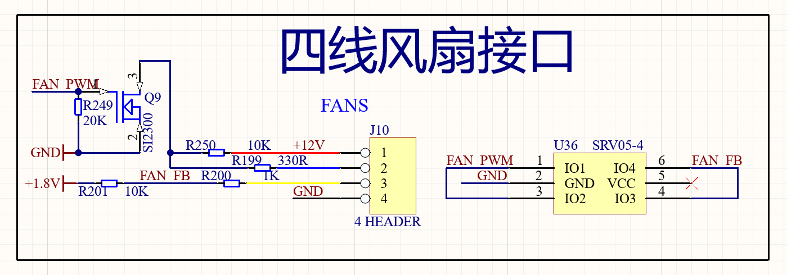
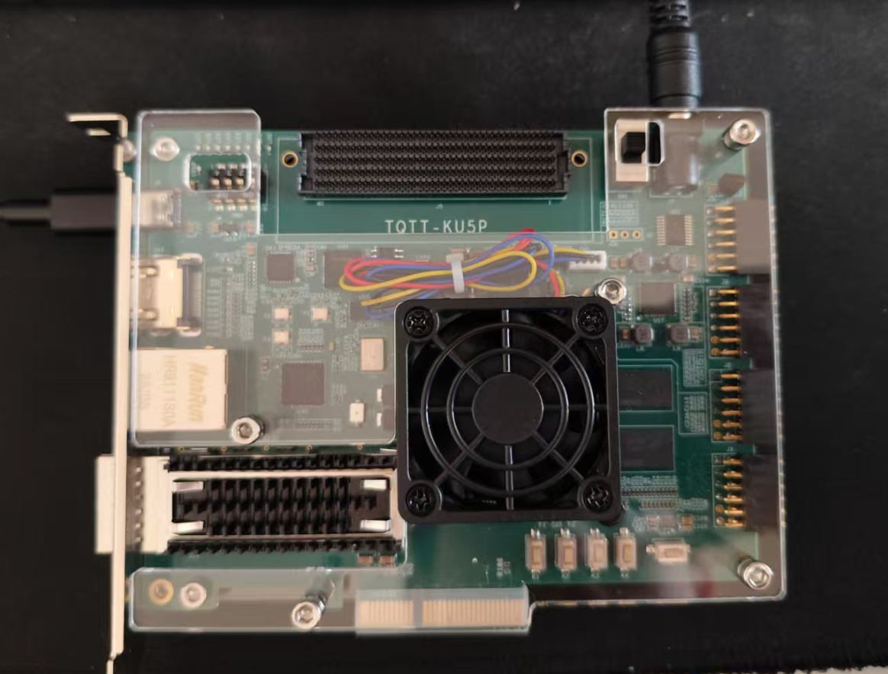
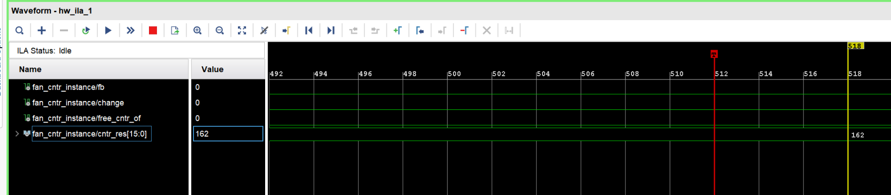
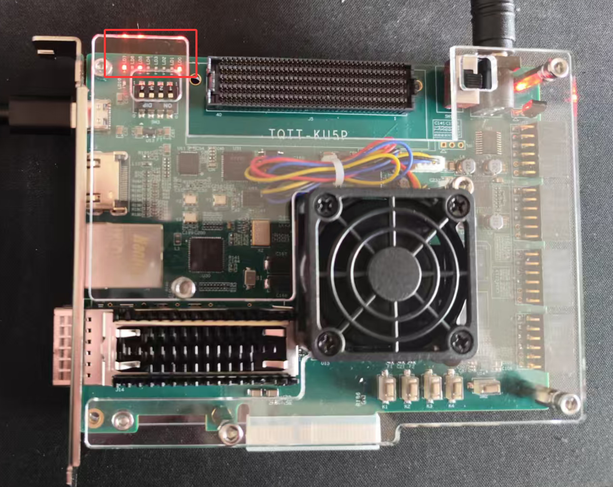

# PWM fan control

This example drives a four-wire fan from a Kintex UltraScale+ KU5P board. It generates a PWM signal, measures the fan feedback signal, and shows the count on eight LEDs.

## Four-wire fan interface

A four-wire fan has these connections:

| Wire | Function |
| --- | --- |
| `VCC` | Usually red. Connect it to the 12 V supply. |
| `GND` | Usually black. Connect it to ground. |
| `Tach` | Usually yellow or green. It gives a square-wave speed feedback signal. Its frequency is proportional to fan speed. |
| `PWM` | Usually blue. PWM duty cycle controls fan speed. |

PWM varies the ratio of high time to period time. For a 10 ms period with 3 ms high time, the duty cycle is 30%. A higher duty cycle gives a higher effective voltage and speed. A 100% duty cycle gives full speed. A 50% duty cycle gives about half speed. A 25% duty cycle gives a lower speed.

## Hardware

Figure 1-1 shows the fan interface. When `FAN_PWM` is high, Q9 pins 2 and 3 conduct and pull J10 pin 2 low. When `FAN_PWM` is low, Q9 does not conduct and R250 pulls J10 pin 2 to 12 V. `FAN_FB` is an open-drain output with a 10 kOhm pull-up resistor. U36, `SRV05-4`, protects the FPGA I/O with ESD diodes.

## Design

The design uses these modules:

| Module | Function |
| --- | --- |
| `fan_pwm` | Top-level module. |
| `pwm_ctlr` | PWM generator. |
| `fan_cntr` | Fan-feedback counter. |
| `ila_1_1_1_16` | ILA instance for speed observation. |

The top-level module uses `FRQ` for the clock rate and `DIV_PER_SECOND` for the count interval. `CLK_50M` is a 50 MHz clock. `FAN_FB` is the feedback input. `FAN_PWM` controls the fan. `LED0` through `LED7` show the low eight bits of the measured count. If any upper count bit is set, all eight LEDs show `8'hff`.

`pwm_ctlr` uses `FRQ`, `PWM_FRQ`, and `OUT_INVERT`. The `value` input ranges from 0 to 99 and represents 0% to 99%. The module limits the effective value to 1 through 99. `pre_div = FRQ / (PWM_FRQ * 100)`. The counter makes 100 intervals per PWM period. It drives the first `value` intervals high and the rest low. Set `OUT_INVERT` to `1` when the external circuit inverts the FPGA PWM signal. This board uses `OUT_INVERT = 1` because a high `FAN_PWM` turns the fan off and a low value gives full speed.

`fan_cntr` samples `FAN_FB` at 1 MHz, detects each rising edge, and counts edges for `FRQ / DIV_PER_SECOND` clocks. `cntr_update` is high when `cntr_res` changes. When `DIV_PER_SECOND` is `1`, the result is the one-second edge count. When it is `5`, the design counts edges for 200 ms.

The project source contains the complete `fan_pwm`, `pwm_ctlr`, and `fan_cntr` RTL in [`fan/fan.srcs/sources_1/new/fan_pwm.v`](fan/fan.srcs/sources_1/new/fan_pwm.v). The three listings in the legacy document match this retained source.

## Program and test

1. Connect board power and JTAG as shown in Figure 1-2.
2. Open `fan/fan.xpr` in Vivado.
3. Generate the bitstream and program the board.
4. Open the ILA view to inspect `fb`, `change`, `free_cntr_of`, and `cntr_res`.

With `DIV_PER_SECOND = 1`, the document shows a measured speed count of 162 per second. The LED display changes with the same value.

The fan runs at full speed while Vivado programs the bitstream. It slows after programming because the example sets `value` to `80`, or 80% of full speed.

## Recovery notes

The source was a legacy WPS `.doc` file. Its OLE container reported an unexpected end of archive, but its `WordDocument`, `0Table`, and `Data` streams were readable. This README captures the technical instructions, five inline PNG images, code identifiers, and numeric values. The recovered document had one malformed hyperlink field around the feedback-pulse phrase. The field target was removed because it did not add technical content.
