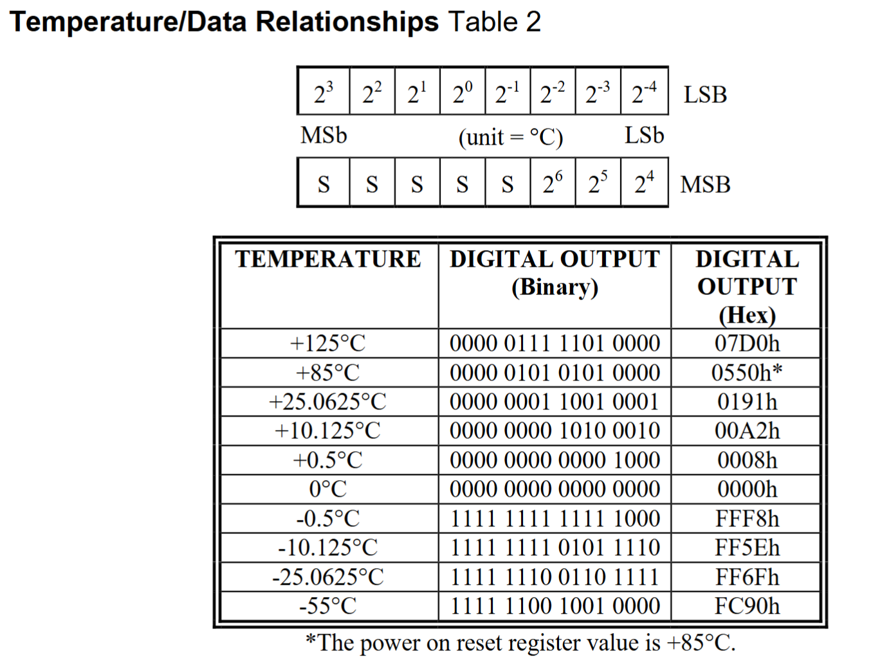
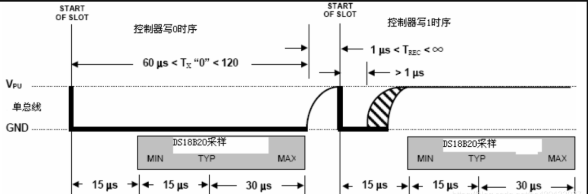
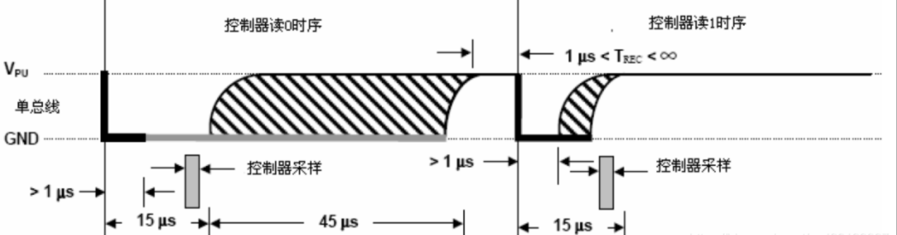
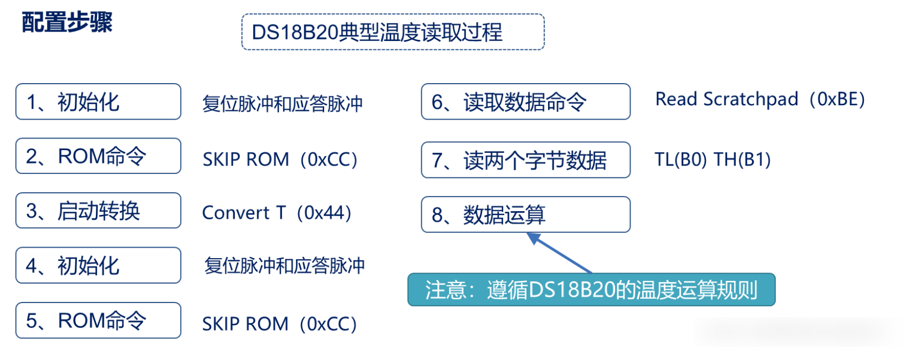
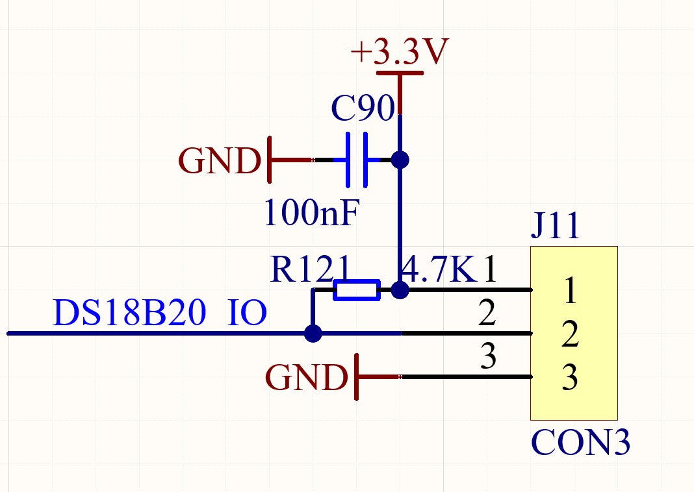
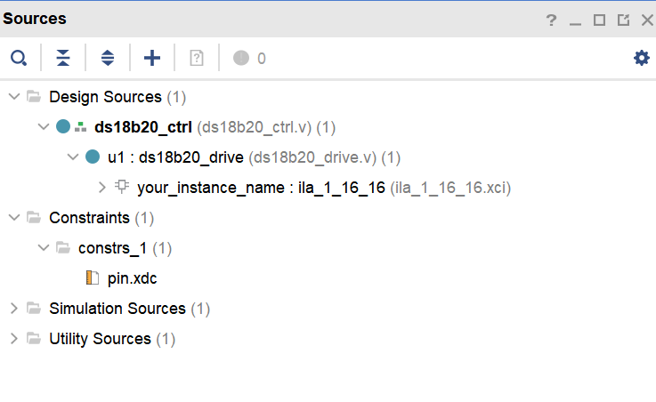
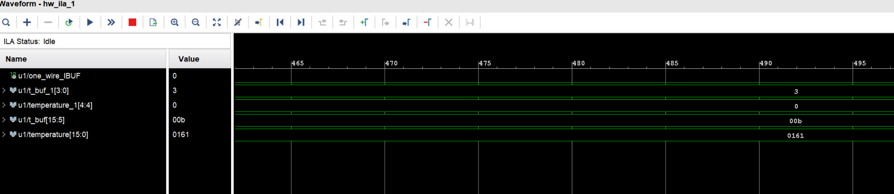
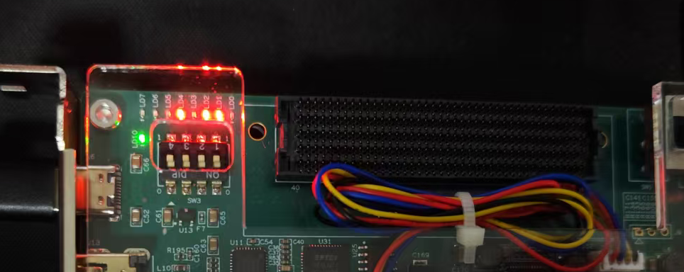

# DS18B20 Temperature Sensor Driver

This example drives the on-board DS18B20 sensor, communicates with the sensor, and displays the measured temperature on LEDs.

## DS18B20

The DS18B20 has these characteristics:

- Temperature range: -55°C to +125°C. Its error is ±0.4° from -10°C to +85°C.
- It returns a 16-bit binary temperature value.
- The host and slave use a one-wire bus for data send and receive.
- It needs no external components.
- Its EEPROM stores the conversion resolution and alarm temperature after power loss.
- Each device has a unique 64-bit ID. You can connect multiple DS18B20 devices to one bus and use ROM search to read each temperature.
- Supply voltage: 2.5 V to 5.5 V.

The returned 16-bit value represents the measured temperature. The high five bits represent the sign. Five `1` bits mean a negative value. Five `0` bits mean a positive value. The remaining 11 bits give the absolute temperature. Convert that value to decimal and multiply it by 0.0625 to get the temperature.

## Communication protocol

The DS18B20 one-wire bus is a half-duplex asynchronous interface. Each device stores a unique 64-bit serial number in ROM. The first 8 bits are the product type code, `28H` for DS18B20. The next 48 bits are the device serial number. The final 8 bits are a CRC value. One bus controller can control one or more slave devices.

Communication has three steps:

1. Initialize the DS18B20.
2. Send a ROM command.
3. Send a DS18B20 function command.

### Initialization

Set the one-wire bus high. The controller then checks for a DS18B20. A present device returns a low pulse. An absent device leaves the bus high.

1. Pull the bus low for at least 480 µs to generate a reset pulse, then release it high.
2. The DS18B20 responds by pulling the signal low for about 60 to 240 µs.
3. Read the bus during this 60 to 240 µs interval. A low level means initialization passed.
4. The DS18B20 releases the bus after 60 to 240 µs.

### ROM commands

| Command | Name | Function |
|---|---|---|
| `0xCC` | Skip ROM | Skip ROM address matching and send a function command to all sensors. |
| `0x28` | Match ROM | Send a 64-bit ROM address. Only the matching sensor responds to later function commands. |
| `0x33` | Read ROM | Read the sensor 64-bit ROM address: family code, serial number, and CRC. |
| `0xF0` | Search ROM | Find all sensors on the bus and get each 64-bit ROM address. |

For one sensor, send `0xCC` to skip ROM.

### Write timing

The bus controller writes a logic `1` or `0` by controlling the duration of the bus high and low levels. Each write transfers one bit. Wait at least 1 µs between two write cycles.

To write `0`, pull the bus low for 60 to 120 µs, then release it. To write `1`, pull the bus low for more than 1 µs, then release it high within 15 µs. The DS18B20 samples the bus from 15 µs through 60 µs after the start of the write slot. A high level writes `1`. A low level writes `0`. Send the least-significant command byte first.

### Read timing

The host pulls the bus low for at least 1 µs, then releases it to read a `1` or `0` from the DS18B20. After the DS18B20 detects the low level, it sends data. It keeps the bus low until the read cycle ends for `0`. It releases the bus high for `1`. Each read slot must last at least 60 µs. Wait at least 1 µs between slots.

Read the low byte first, then the high byte. Read scratchpad byte 0 for the low eight temperature bits and byte 1 for the high eight temperature bits. Normal temperature reading needs these two bytes.

### Function commands

Send a function command after a ROM command to measure temperature, configure the device, or read data.

| Command | Name | Function |
|---|---|---|
| `0x44` | Start conversion | Start temperature measurement. The sensor pulls `DQ` low during conversion and stores the result in RAM. |
| `0xBE` | Read scratchpad | Read nine scratchpad bytes, including temperature, resolution, and alarm thresholds. |
| `0x4E` | Write scratchpad | Write three bytes, `TH`, `TL`, and the configuration register. |
| `0x48` | Copy scratchpad | Copy `TH`, `TL`, and configuration data to EEPROM. |
| `0xB8` | Recall EEPROM | Copy EEPROM `TH`, `TL`, and configuration data to the scratchpad. |
| `0x31` | Read temperature | Read two temperature bytes, the same as scratchpad bytes 0 and 1. |

## Hardware

The DS18B20 pin 1 connects to 3.3 V. Pin 2 connects to the FPGA and has a 4.7 kΩ pull-up resistor. The pull-up keeps the idle one-wire bus high. Pin 3 connects to GND.

## Project code

The project contains three modules. `ds18b20_ctrl` is the top-level file. `ds18b20_drive` drives the DS18B20. An ILA instance in `ds18b20_drive` shows the measured temperature.

`ds18b20_ctrl` instantiates `ds18b20_drive`. It converts the measured temperature to eight LEDs without the decimal fraction. Four LEDs show the tens digit and four LEDs show the ones digit.

`ds18b20_drive` implements the one-wire protocol. It resets the sensor, detects its presence, sends commands, reads and parses temperature data, and outputs a decimal temperature value. The ILA observes the temperature directly. The `one_wire` port is a bidirectional communication port. The `temperature` port outputs the parsed decimal value.

The module parses each 16-bit raw value as follows:

- `temperature[3:0]`: the low four bits multiplied by 0.0625°C, as decimal fraction `0` through `9`.
- `temperature[11:4]`: the integer part, with carry handling.
- `temperature[15]`: raw data bit 12. `1` means a negative temperature and `0` means a positive temperature.

The complete Verilog source is in [ds18b20_ctrl.v](ds18b20/ds18b20.srcs/sources_1/new/ds18b20_ctrl.v) and [ds18b20_drive.sv](ds18b20/ds18b20.srcs/sources_1/new/ds18b20_drive.sv).

## Board test

Open the project and refer to the *Program and Store the Program* guide. Generate the bitstream and program the board. The ILA window appears.

In the shown result, `temperature` is `161`, which represents 16.1°C. The upper-left LED on the development board lights.

A lit LED means `1` and an unlit LED means `0`. The eight LEDs show `00010110`. Divide this into `0001 0110` to get 16. This displays only the tens and ones digits and agrees with the ILA result.
