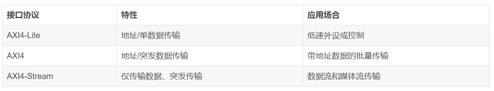
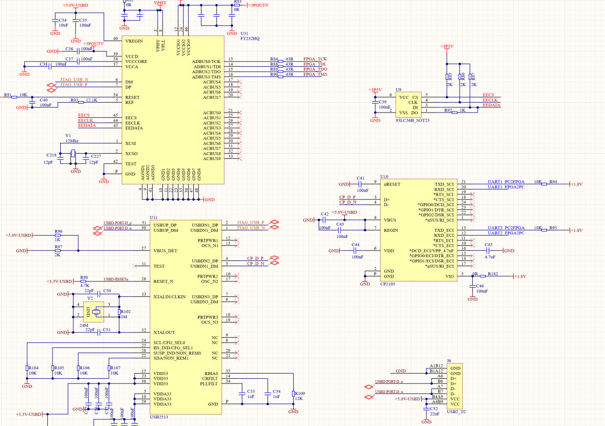
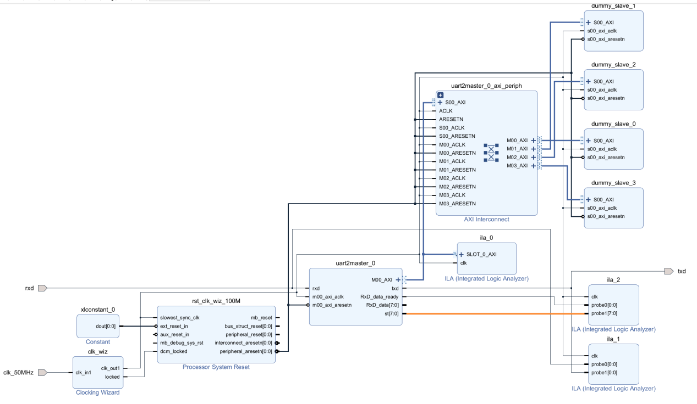
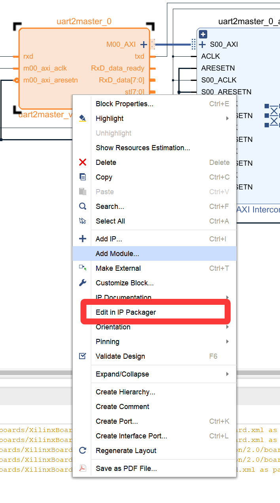
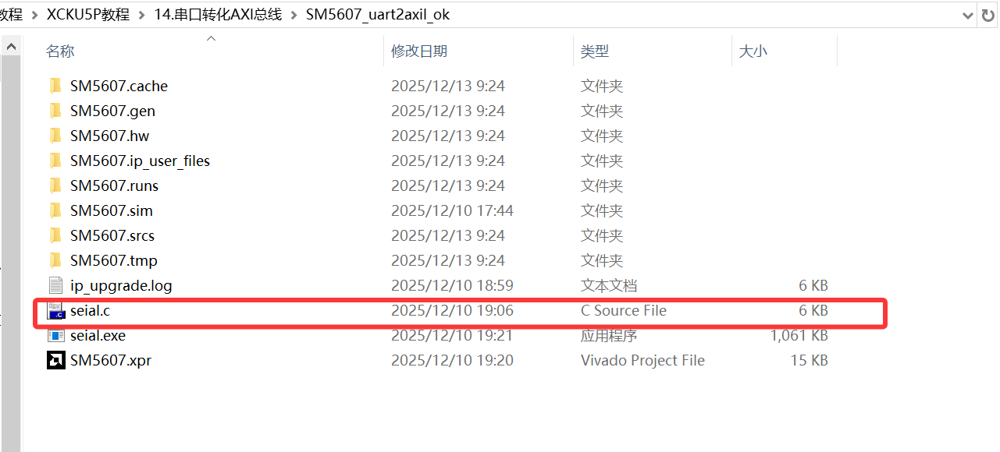
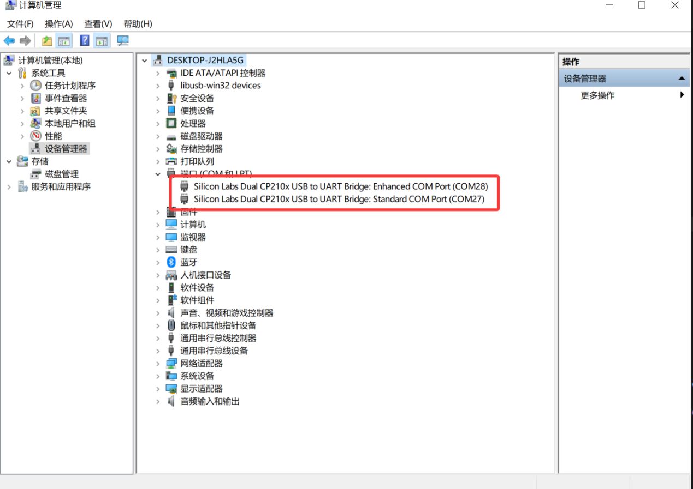
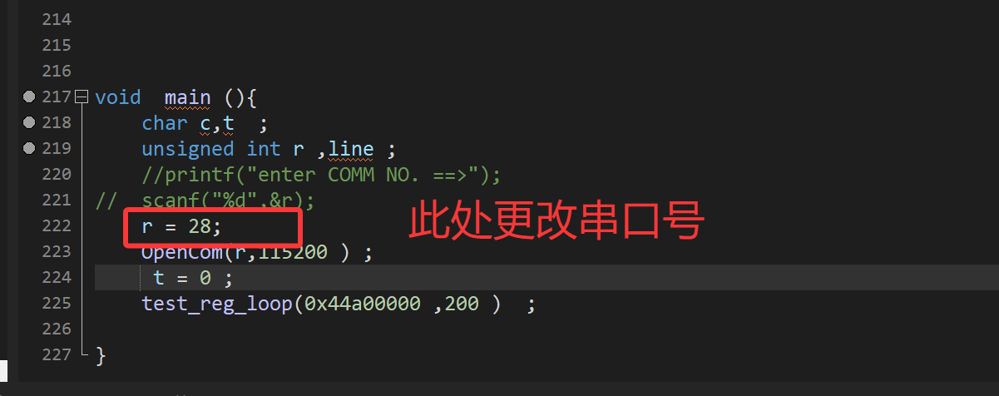
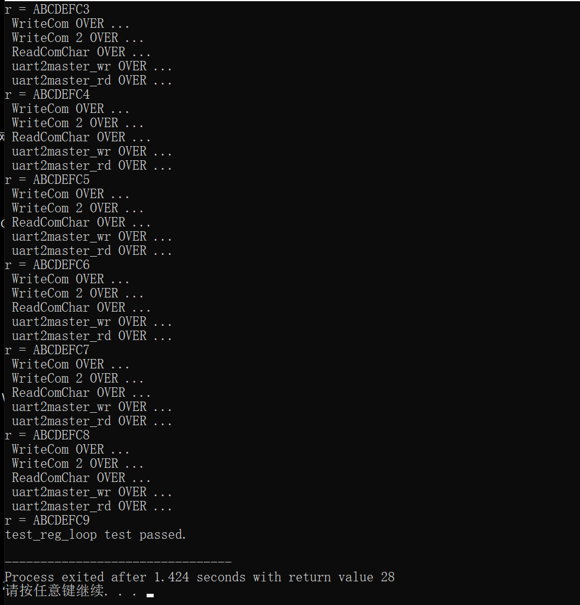

# UART to AXI Lite Master

This example converts a UART port inside the FPGA to an AXI Lite master port. The standardized interface can be used elsewhere in a design. The project implements a UART-to-AXI Lite master loopback test. It also supports later MS5607 barometer work.

## AXI bus

AXI means Advanced eXtensible Interface. Xilinx introduced this interface protocol with the 6-series FPGA family. It defines data transfer between master and slave devices. Zynq devices use AXI4. These devices combine an ARM Cortex-A9 processor and FPGA logic on one chip. AXI gives the processor and FPGA high-speed communication and data exchange.

Zynq supports AXI-Lite, AXI4, and AXI-Stream.

### AXI4

AXI4 is part of the ARM AMBA specification and succeeds AXI3. It suits high-bandwidth, low-latency integrated circuits such as systems on chip and large FPGA designs.

- An AXI4 burst can contain up to 256 transfers. AXI3 supports at most 16 transfers per burst.
- Quality-of-service signals mark transaction urgency or priority. An interconnect can use these signals to manage master bandwidth and latency.
- Region interfaces assign different attributes to address-space regions, such as access permissions or cache policy.

### AXI4-Lite

AXI4-Lite is a simpler AXI4 interface for small peripherals and control registers.

- Each burst length is 1. Each read or write transfers one data item.
- Every transfer has the data-bus width. For example, a 32-bit bus transfers 32 bits on each access.
- It does not support exclusive accesses or locked transactions.

AXI4 and AXI4-Lite are memory-mapped protocols. They each use five unidirectional channels:

- Read address channel
- Write address channel
- Read data channel
- Write data channel
- Write response channel

The master sends a read address through the read-address channel. The slave returns requested data through the read-data channel. The master sends write addresses and data through the write-address and write-data channels. The slave sends write status through the write-response channel. Independent channels can transfer data in parallel.

### AXI4-Stream

AXI4-Stream transfers one-way continuous data, such as audio, video, or network packets. It supports multiple data streams on shared wiring and different data widths in one interconnect. It suits FPGA designs because it supports simple point-to-point, low-latency transfers. Key signals include `TDATA`, `TVALID`, and `TREADY`. Optional signals include `TSTART`, `TERROR`, and user-defined signals.

AXI is a point-to-point master and slave protocol. AXI4 allows up to 256 data transfers in a burst. AXI4-Lite allows one data transfer per transaction. A master starts reads and writes. A slave responds to the master.

## UART

UART, SPI, and IIC are common low-speed buses. UART is asynchronous. The receiver does not know when data arrives, so transmit and receive sides each use a clock. The data transfer does not carry a clock. Start and stop bits synchronize the receiver. SPI and IIC are synchronous and transfer a clock with data.

UART uses `tx` for transmit and `rx` for receive. Connect PC `tx` to FPGA `rx`, and PC `rx` to FPGA `tx`. UART is full duplex.

This document uses RS232. RS232 is a UART type with no clock line and two one-bit data lines, `rx` and `tx`. When a PC sends eight bits to the FPGA, the FPGA receives them from least significant bit through most significant bit. It then combines them into an 8-bit value. The FPGA sends data in the same order through `tx`.

Each data frame has one start bit, eight data bits, and one stop bit. The start bit is `0`, and the stop bit is `1`. `rx` and `tx` remain high when idle.

Baud rate is the number of symbols per second. Its unit is baud per second, Bps. Common UART rates include 4800, 9600, and 115200. This tutorial explains UART at 9600 baud. Bit rate equals baud rate multiplied by the number of binary bits per symbol. At 9600 baud with one bit per symbol, the bit rate is `9600 Bps * 1 bit = 9600 bps`.

One bit at 9600 baud takes `1 / 9600` s. A 50 MHz system clock has a 20 ns period. The required count is about 5208 system-clock cycles per bit.

## Hardware resources

The development board Type-C connector supplies a serial interface and JTAG. A USB2513 device converts it to two signal paths. One path goes to an FT232HQ for JTAG. The other goes to a CP2105 that converts it to two serial ports. The board has two usable serial ports. This project uses the second port.

## Project code

The project uses a Block Design. `uart2master` is the key module. It implements UART-to-AXI Lite master conversion.

Open the IP internals to view the `uart2master` module.

The host program calls `OpenCom` and `test_reg_loop`. Variable `r` is the serial-port number. Set it to the detected port number. `OpenCom` opens that port at 115200 baud. `test_reg_loop` writes 200 values to address `0x44a00000` to test the UART loopback.

The complete UART RTL is in [uart2master.v](SM5607_uart2axil_ok/ip_repo/ip_repo/uart2master_1_0/hdl/uart2master.v). The AXI master RTL is in [uart2master_master_lite_v1_0_M00_AXI.v](SM5607_uart2axil_ok/ip_repo/ip_repo/uart2master_1_0/hdl/uart2master_master_lite_v1_0_M00_AXI.v). The host source is [seial.c](SM5607_uart2axil_ok/SM5607_uart2axil_ok/seial.c).

## Board test

Open the project. Refer to the *Program and Store the Program* guide. Generate the bitstream and program the board. The project folder contains `seial.c`.

Open `seial.c` in an editor. After you connect the hardware, open Windows Device Manager and identify the two serial ports. The shown system detects ports 28 and 27. Your port numbers can differ.

Set variable `r` in `seial.c` `main` to one detected port, 27 or 28 in the example.

The shown result uses port 28 for loopback. It means that the UART-to-AXI loopback test passes.

