# MS5607 Barometer Driver

This example drives an MS5607 barometer through SPI in the FPGA. It sends measured data to the host through a UART-to-AXI Lite master. The host uses the data sheet equations to calculate altitude, temperature, and pressure, then shows them in a terminal. Read the UART-to-AXI Lite Master example first.

## MS5607

The MS5607-02BA is a MEAS high-resolution pressure sensor. It supports SPI and I2C, has a 24-bit ADC and factory calibration coefficients, and can work as an altimeter, barometer, or thermometer.

- Altitude resolution: 20 cm.
- Conversion time: 0.48 ms at `OSR=256` through 9.04 ms at `OSR=4096`.
- Peak conversion current: 1.4 mA. At one `OSR=4096` conversion per second, current is 12.5 µA. Typical standby current at 25°C is 0.02 µA.
- Package size: 5.0 mm × 3.0 mm × 1.0 mm.
- Supply voltage: 1.8 V to 3.6 V.
- Pressure range: 10 to 1200 mbar. Full accuracy range: 300 to 1100 mbar.
- Pressure accuracy: ±1.5 mbar at 25°C and 750 mbar. It is ±2.5 mbar from -20°C to 85°C and 300 to 1100 mbar after one-point calibration.
- Maximum pressure resolution: 0.024 mbar at `OSR=4096`.
- Temperature range: -40°C to +85°C. Accuracy is ±0.8°C at 25°C and ±4°C maximum from -40°C to 85°C.
- Interfaces: I²C and SPI, up to 20 MHz.

Each sensor has factory calibration at two temperatures and two pressures. Its 128-bit PROM stores six coefficients. Host software must read them and use them with D1 and D2 to calculate compensated pressure and temperature.

## Commands and interfaces

The MS5607 has five basic commands:

1. Reset
2. Read the 128-bit PROM calibration data
3. Start D1 pressure conversion
4. Start D2 temperature conversion
5. Read the 24-bit ADC pressure or temperature result

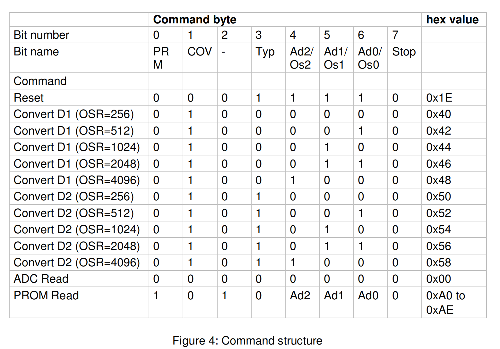

Pull `PS` low to select SPI. Pull `PS` high to select I2C.

### SPI mode

The controller sends data through `SCLK` and `SDI`. The sensor returns data through `SDO`. It supports SPI modes 0 and 3. `CSB` enables or disables the interface. Keep the SPI bus idle during ADC conversion for best interference resistance.

After power-on, send reset command `0x1E`. Wait 2.8 ms for PROM reload.

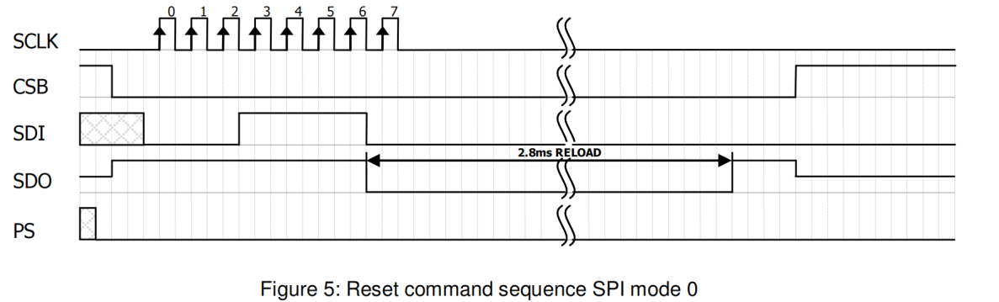

Read PROM with commands `0xA0` through `0xAE`. PROM has eight addresses. Address 0 stores factory data and configuration. Addresses 1 through 6 store coefficients `C1` through `C6`. Address 7 stores the serial number and CRC. The command is 8 bits and returns 16 bits, most-significant bit first.

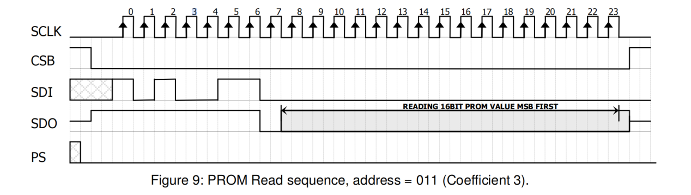

Pressure-conversion commands are `0x40`, `0x42`, `0x44`, `0x46`, and `0x48` for OSR 256, 512, 1024, 2048, and 4096. Temperature-conversion commands are `0x50`, `0x52`, `0x54`, `0x56`, and `0x58` for the same OSR values. The sensor stays busy during conversion. An incomplete or repeated ADC read returns zero. An interrupted conversion gives an invalid result.

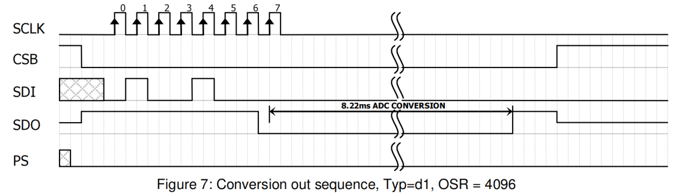

After conversion, send `0x00` to read the 24-bit D1 pressure or D2 temperature result, most-significant bit first.

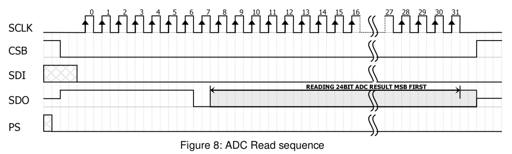

### I2C mode

I2C uses the bidirectional `SDA` pin and needs two signal lines. Its address is `111011Cx`, where `C` is the inverse of the `CSB` level. Connect two sensors with `CSB` at `VDD` and `GND` to use two addresses. Do not leave `CSB` unconnected.

You can send reset at any time. If power-on reset fails because an acknowledge state holds `SDA`, send several `SCLK` cycles, then send reset or cycle power.

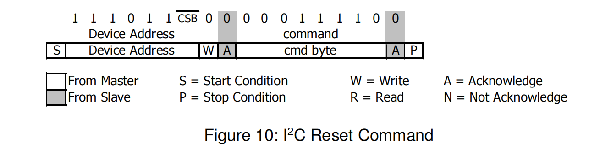

The I2C PROM read command has two parts. The first selects PROM read mode. The second receives data.

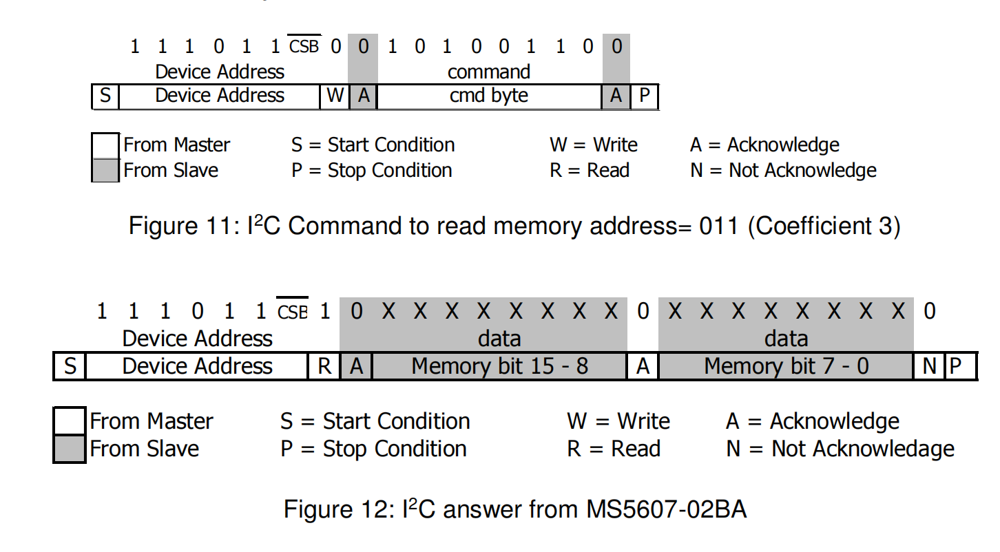

Send a conversion command to start conversion. The device stays busy until it completes. Then send a read command. After acknowledgement, send 24 `SCLK` cycles to receive all result bits. The system waits for acknowledgement after each 8 bits.

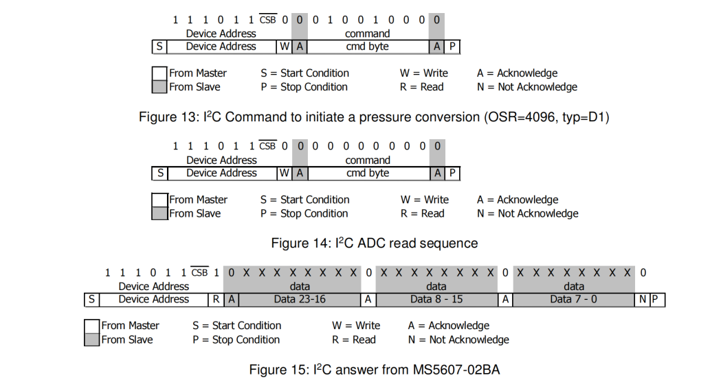

The 128-bit PROM includes a 4-bit CRC to check data validity. Application note AN520 describes the CRC-4 algorithm.

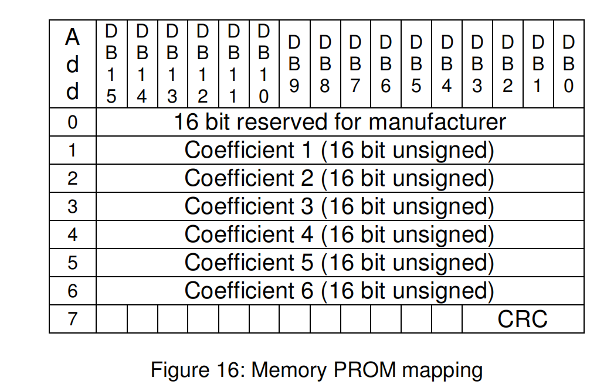

Use the shown equations to calculate pressure, temperature, and altitude.

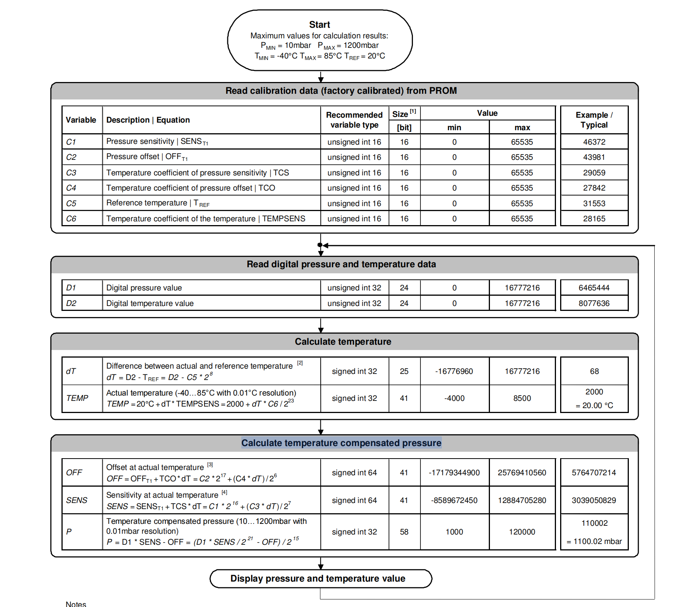

## Hardware resources

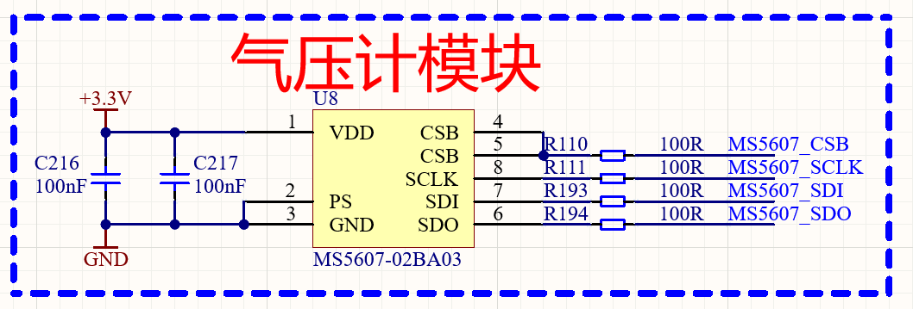

The board connects `PS` to GND, so it uses SPI. The sensor uses 3.3 V and connects to FPGA bank 86.

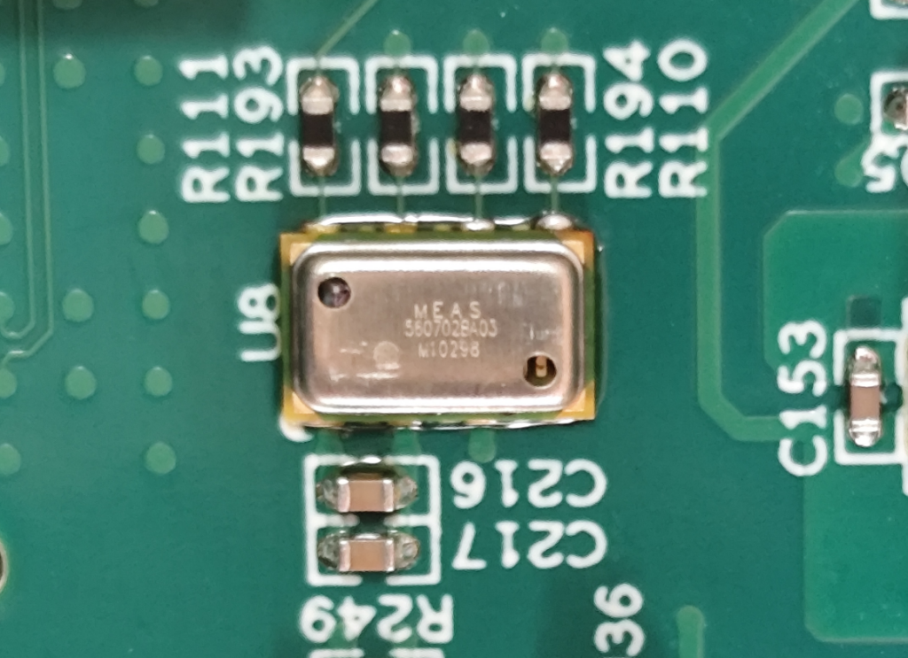

## Project code

The project uses an IP-based modular design. `uart2master` and `ms5607_man` are the key modules. `uart2master` is described in the UART-to-AXI example. `ms5607_man` converts MS5607 SPI data to AXI.

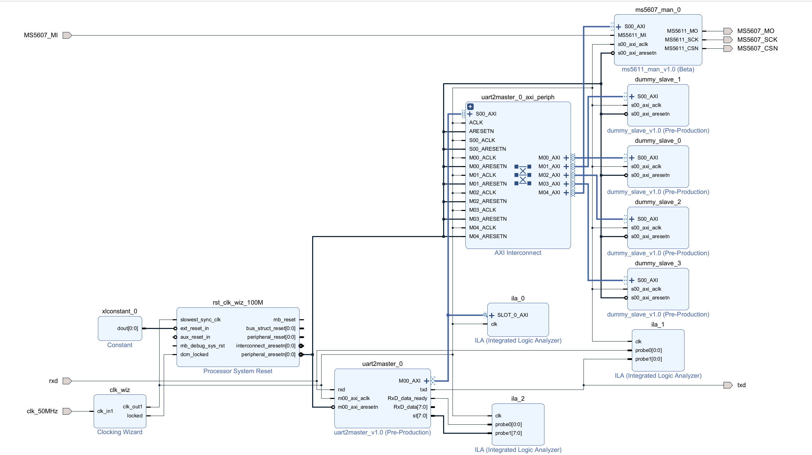

The IP project has four modules: `ms5611_man` is the SPI driver, `sc_fifo` buffers its output, `ms5611_man_v1_0_S00_AXI` converts FIFO data to AXI, and `ms5611_man_v1_0` is the top-level module. The MS5611 and MS5607 driver code is the same.

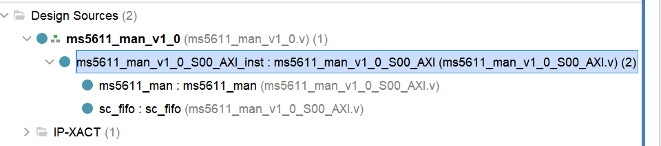

The host program adds `test_ms5607_1`. It calculates pressure, temperature, and altitude from MS5607 data. Refer to the MS5607 data sheet and the calculation figure for the formulas. The restored project files are [TOP.v](SM5607_OK/SM5607.srcs/sources_1/new/TOP.v), [design_1_wrapper.v](SM5607_OK/SM5607.srcs/sources_1/imports/hdl/design_1_wrapper.v), [MS5607 IP configuration](SM5607_OK/SM5607.srcs/sources_1/bd/design_1/ip/design_1_ms5611_man_0_0/design_1_ms5611_man_0_0.xci), [ms5611.c](SM5607_OK/ms5611.c), and [seial.c](SM5607_OK/seial.c).

## Board test

Open the project. Refer to the *Program and Store the Program* guide. Generate the bitstream and program the board. The project folder contains `seial.c`.

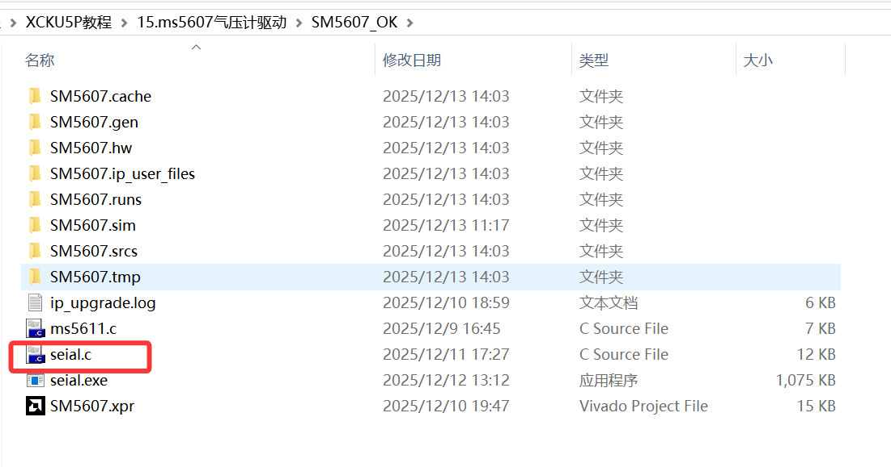

Open the file, find `main`, identify the serial port in Device Manager, and set variable `r` to that port number. Refer to the UART-to-AXI Lite Master example for port identification.

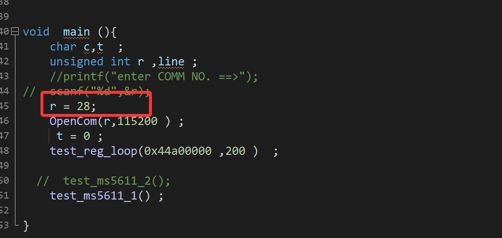

After you program the bitstream and select the serial port, run `seial.c`. The terminal shows pressure, temperature, and altitude. Factory parameters have these meanings:

- `fc[0]`: pressure sensitivity
- `fc[1]`: pressure offset
- `fc[2]`: temperature sensitivity
- `fc[3]`: temperature offset
- `fc[4]`: reference temperature
- `fc[5]`: temperature coefficient

`Pressure` has units of mbar. Example: `110002` means 1100.02 mbar. `Temp` has units of degrees Celsius. Example: `2000` means 20°C. `Height` has units of meters. Example: `5404` means 54.04 m.

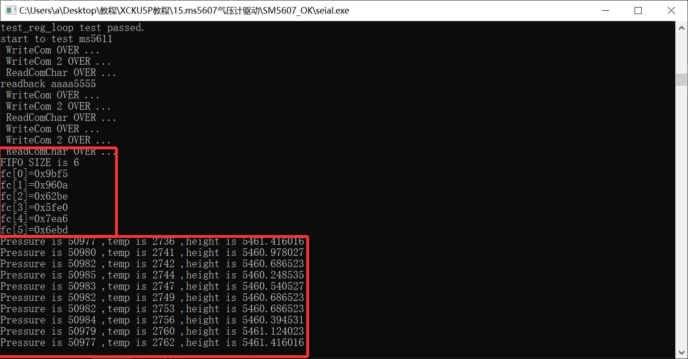
